# C语言实验报告

实验一至七的脱敏公开版，包含实验目的、实验内容、各题说明及 56 张 Visual Studio 2022 实际运行截图。

## 摘要

本报告记录 C 语言课程实验一至七的程序实现、调试过程和运行结果，涉及基本输入输出、顺序结构、选择结构、循环结构、数组、函数、递归及指针。各题在 Windows 的 Visual Studio 2022 开发者 PowerShell 中使用 MSVC（x64，C17）分别编译和运行。报告中的截图显示对应的源码文件和测试输出，完整源码、输入用例和日志随工程保存。

关键词  C语言、程序设计、数组、递归、指针

## 实验目录

实验一  C/C++语言程序认识与调试（7 个程序）

实验二  顺序结构程序设计（7 个程序）

实验三  选择结构程序设计（10 个程序）

实验四  循环结构程序设计（8 个程序）

实验五  数组的定义及其应用（9 个程序）

实验六  函数的定义及其应用（6 个程序）

实验七  指针的定义及其应用（9 个程序）

## 实验一  C/C++语言程序认识与调试

实验目的  熟悉 C 程序的组成，在 Visual Studio 2022 中完成编辑、编译、链接和运行，识别常见的编译及运行错误。

实验内容  从最简单的输出程序开始，分别观察保留和去掉换行符时的终端显示。接着输入两个逗号分隔的整数，分别在主函数中求和、调用 add 函数求和。最后修改四段有问题的代码，处理头文件、语句分号、变量声明与初始化、赋值和输出格式，运行修正后的程序。

### 1.1  1. 输出 Hello, C! 并观察换行

默认输出末尾的 \\n 使下一行从行首开始。使用 plain 参数去掉 \\n 后，紧随其后的结束标记接在同一行。

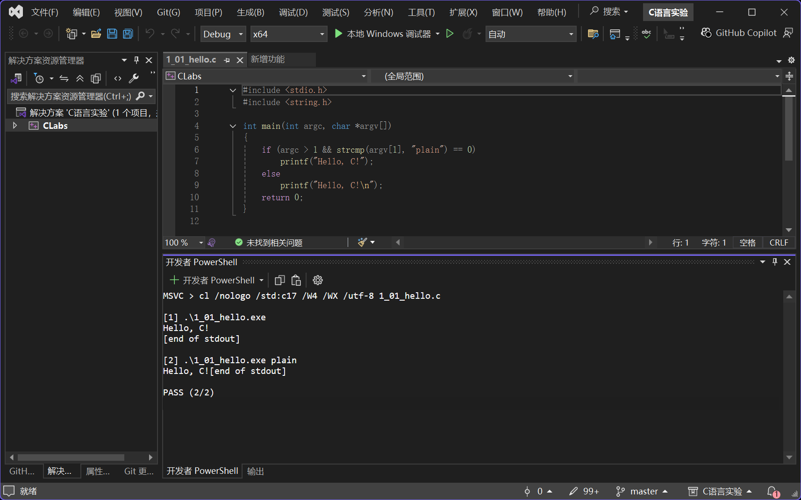

图 1-1  1\_01\_hello.c 的运行截图

### 1.2  2. 输入两个整数并计算和

等待输入时题给程序没有打印提示。输入 7,−3 后输出问候语和整数和 4。scanf 格式中的逗号必须与输入匹配。

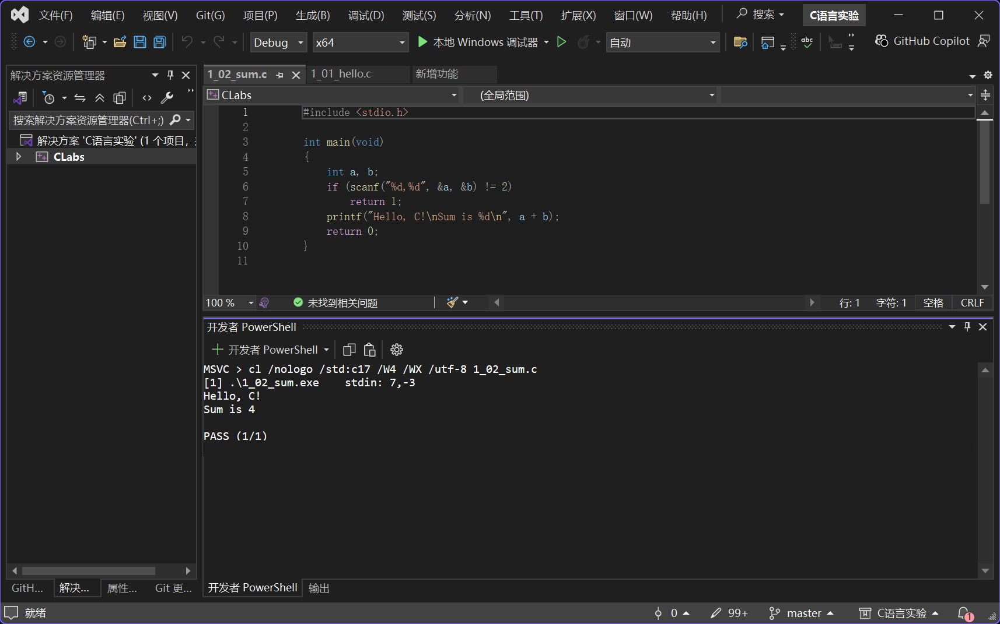

图 1-2  1\_02\_sum.c 的运行截图

### 1.3  3. 调用 add 函数求和

这一题先显示输入提示，将加法封装在 add 中并由 main 调用。对相同输入，计算结果与第 2 题一致。

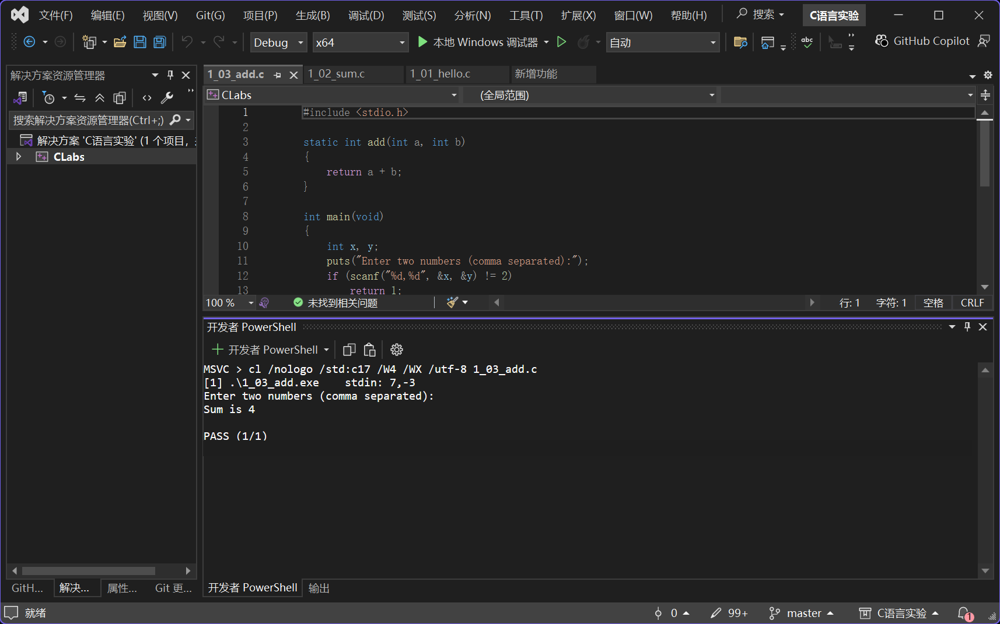

图 1-3  1\_03\_add.c 的运行截图

### 1.4  4(1). 改错  printf 语句

补充 \<stdio.h\>、main 的返回类型和 printf 语句后的分号。

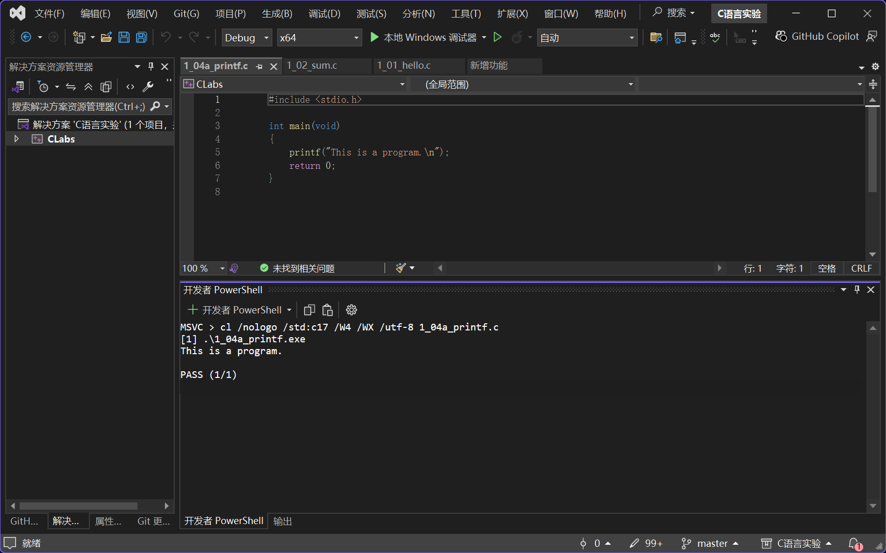

图 1-4  1\_04a\_printf.c 的运行截图

### 1.5  4(2). 改错  计算平方

声明 int x，并去掉 scanf 格式末尾的空格，避免继续等待非空白字符。输入 −6 得 36。

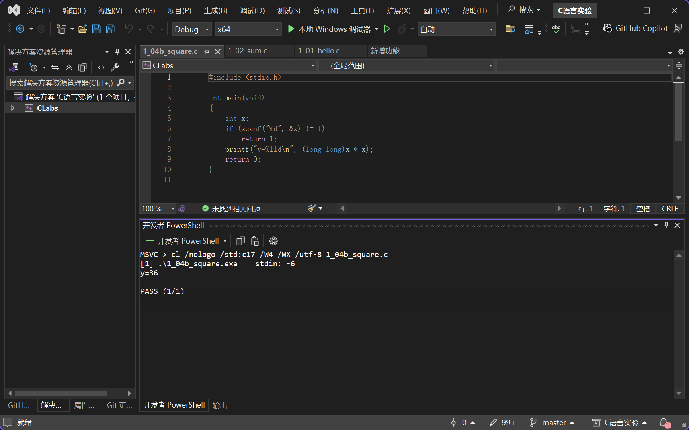

图 1-5  1\_04b\_square.c 的运行截图

### 1.6  4(3). 改错  变量初始化

b 是未初始化的局部变量。为演示赋初值 5，a 为 7，因此和为 12。

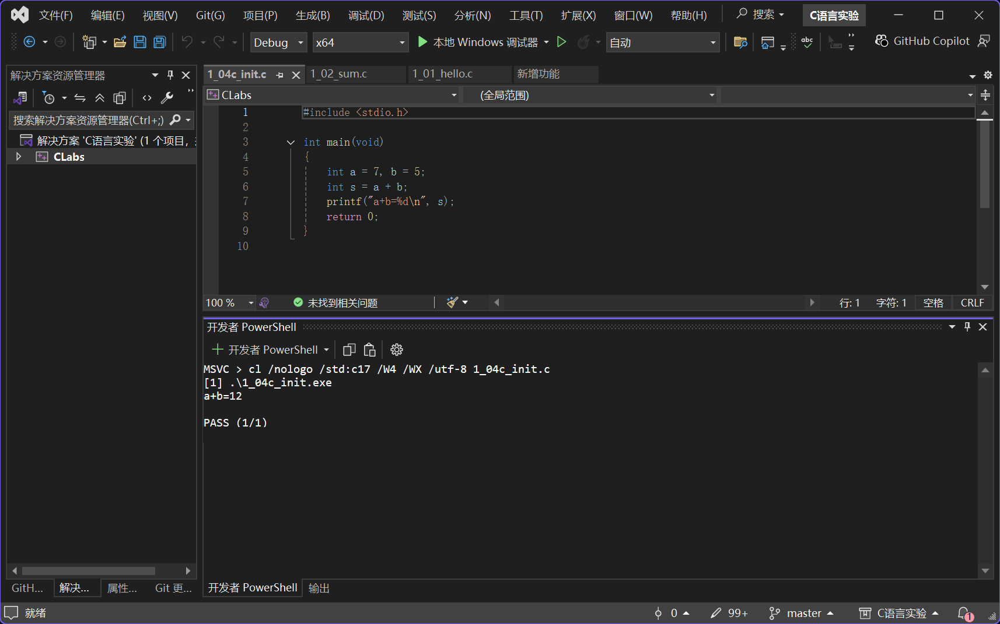

图 1-6  1\_04c\_init.c 的运行截图

### 1.7  4(4). 改错  三数平均值

在 c 与 sum 之间加逗号，用 = 完成赋值，并使用浮点输出格式 %.2f。平均值约为 21.67。

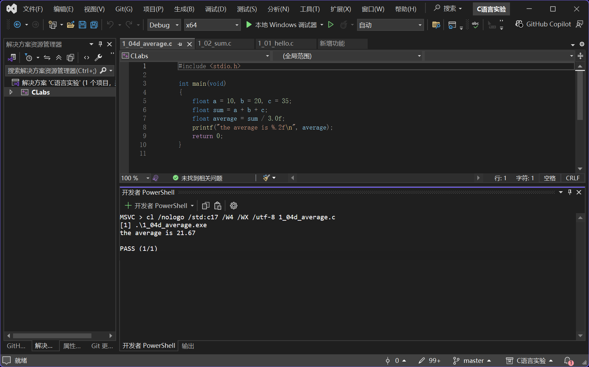

图 1-7  1\_04d\_average.c 的运行截图

## 实验二  顺序结构程序设计

实验目的  练习 int、float、char 等基本类型，使用表达式、赋值和格式化输入输出编写顺序结构程序。

实验内容  按「输入数据、计算、输出」的顺序编写程序。输入三个系数，用判别式求实根，分别验证两个不同实根和重根。按讲义给定的排列输出 5×5 字符图案。练习还包括修正三数求和与求积的代码、核对格式说明符与变量类型，以及用整数和浮点数完成四则运算和存款本息计算。

### 2.1  一. 求一元二次方程的实根

按输入、计算判别式、求根、输出的顺序执行。a 必须非零，判别式必须非负。保留两位小数。

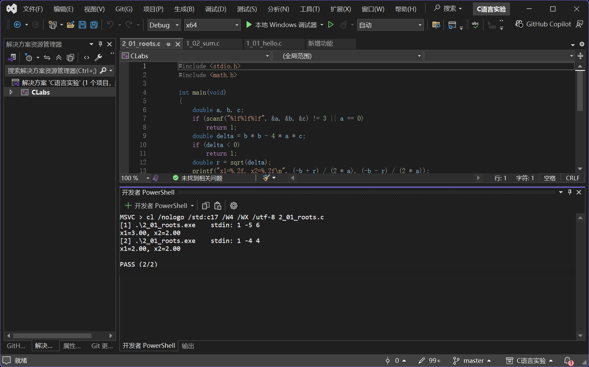

图 2-1  2\_01\_roots.c 的运行截图

### 2.2  二. 输出特殊图案

保留题给 5×5 字符排列。原例的 176、219 分别是 CP437 的浅阴影与实心方块，在 Visual Studio 2022 终端中直接输出对应的 UTF-8 字符。

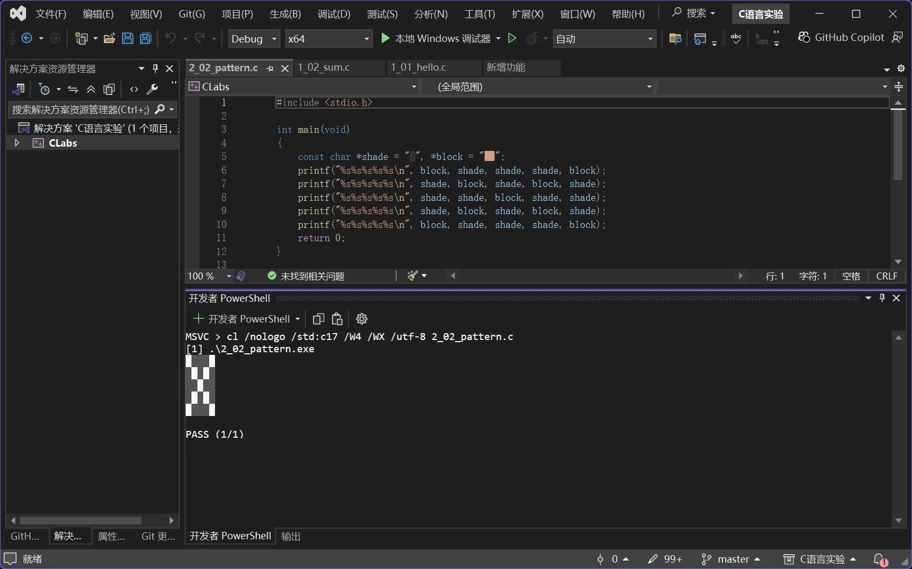

图 2-2  2\_02\_pattern.c 的运行截图

### 2.3  DIY 一  改错  三数的和与乘积

去掉多余标点，补齐分号。依照题给输入格式，让第三个数及相关乘积使用浮点类型，输出表达式的值，去掉误加的取地址符。

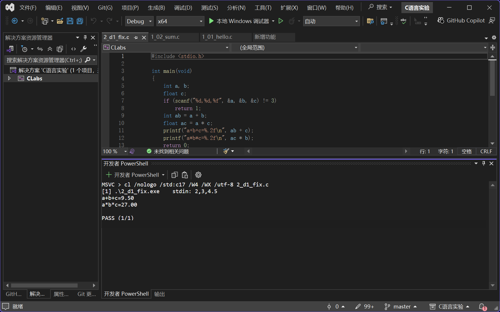

图 2-3  2\_d1\_fix.c 的运行截图

### 2.4  DIY 二  判断格式化输出

第 1 组依次显示 10、10、10.000000、10.000000。第 2 组将 long 传给 %d、int 传给 %ld，第 3 组将浮点数传给 %d，原代码行为未定义。截图运行的是按实参类型修正后的三组；printf 中 float 按规则提升为 double。

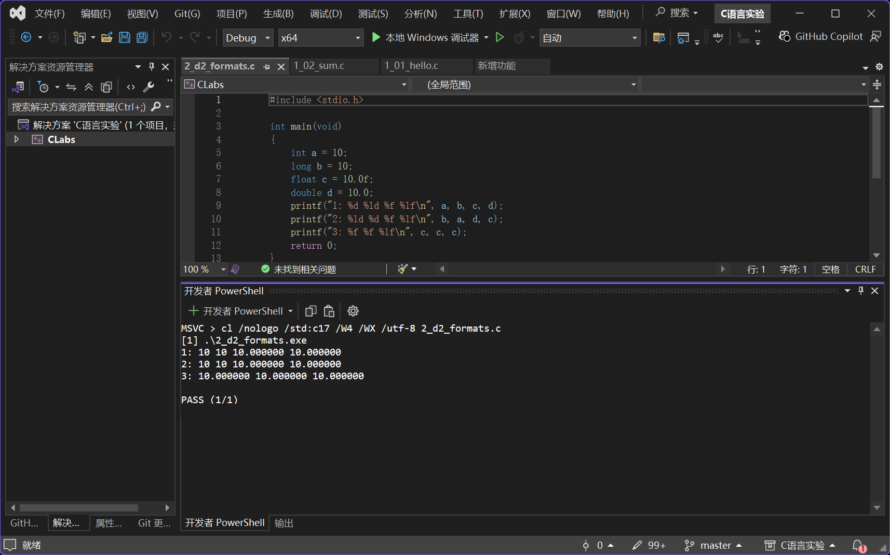

图 2-4  2\_d2\_formats.c 的运行截图

### 2.5  DIY 三(1)  输出浮点数的和

把 3.4 和 9.0 的和以两种格式输出，操作数保留一位小数，结果保留两位。

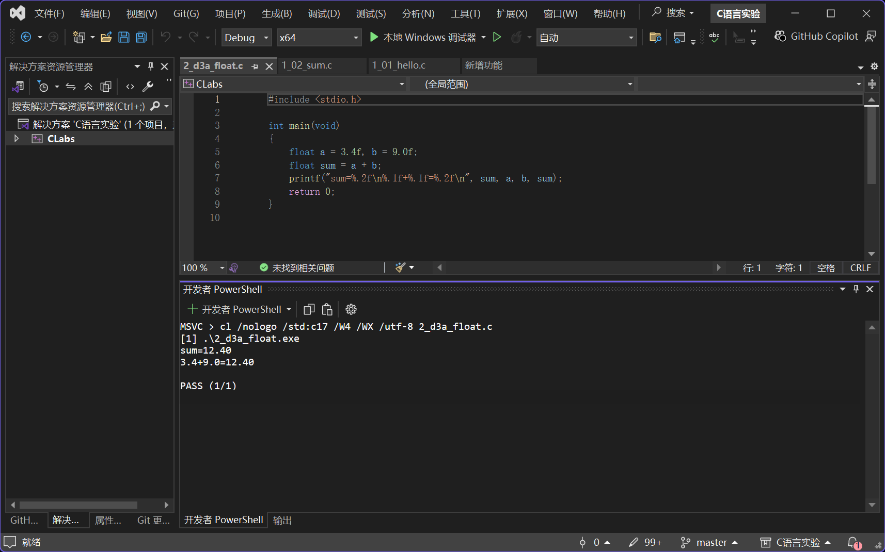

图 2-5  2\_d3a\_float.c 的运行截图

### 2.6  DIY 三(2)  整数运算和余数

输入 17 和 5，整数商为 3，余数为 2。除数为 0 时仍输出和、差、积，并提示无法求商和余数。

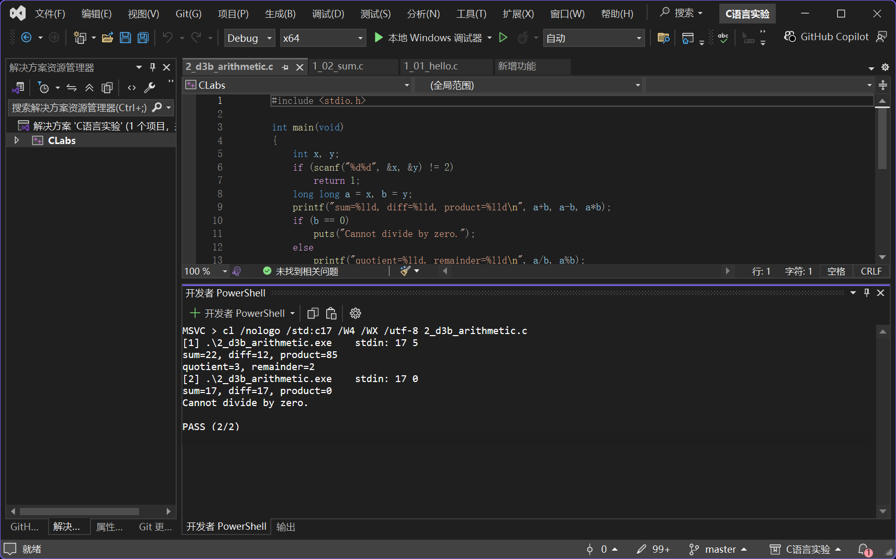

图 2-6  2\_d3b\_arithmetic.c 的运行截图

### 2.7  DIY 三(3)  计算存款本息（选做）

按本金 × (1+年利率) 的存期次幂计算。输入 1000 元、2 年、年利率 0.03，得到 1060.90 元。

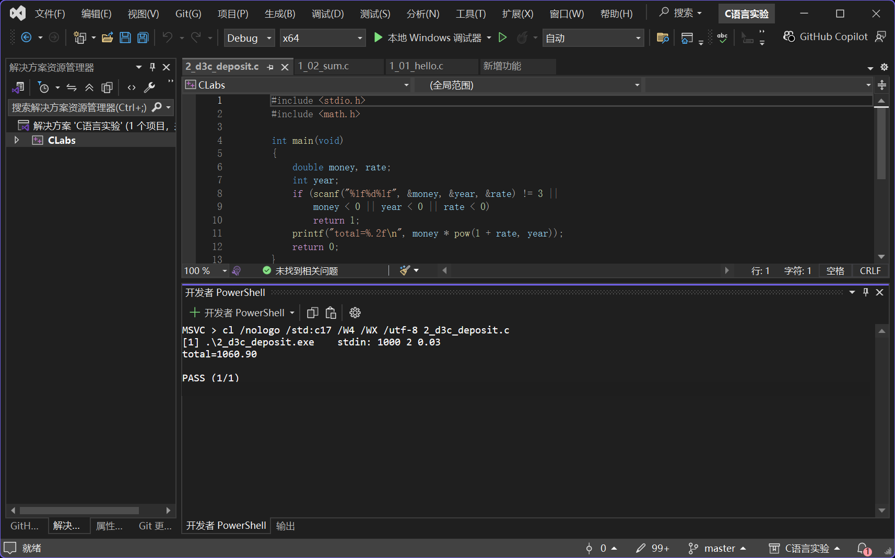

图 2-7  2\_d3c\_deposit.c 的运行截图

## 实验三  选择结构程序设计

实验目的  使用关系与逻辑运算符构造条件，练习 if、if–else 和 switch 选择结构。

实验内容  为同一程序设计不同的执行分支。先用 x 为正、为零、为负三种输入验证分段函数，再根据二次项系数和判别式区分方程的根。用 switch 实现简单计算器，并用不同输入检验三数取最小值、闰年二月天数、整数判断和排序、出租车计费及成绩分级。

### 3.1  一. 分段函数

x\>0 时计算 (x+5)²+3x，x=0 时得到 0，x\<0 时计算 (x−5)²−3x。用 2、0、−2 覆盖三个分支。

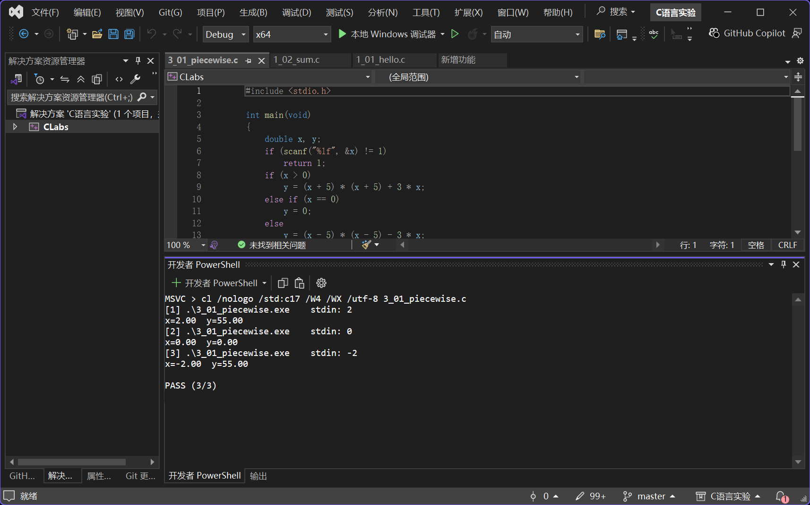

图 3-1  3\_01\_piecewise.c 的运行截图

### 3.2  二. 判断一元二次方程的根

先判断 a 是否为 0。对二次方程按判别式符号分别输出两个不等实根、重根或一对共轭复根。

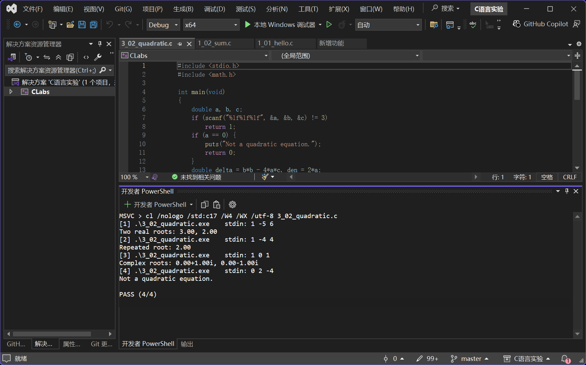

图 3-2  3\_02\_quadratic.c 的运行截图

### 3.3  三. 计算简单四则表达式

scanf 中 %c 前的空格允许输入诸如 2 + 45 的形式。switch 选择运算，除法分支检查除数。

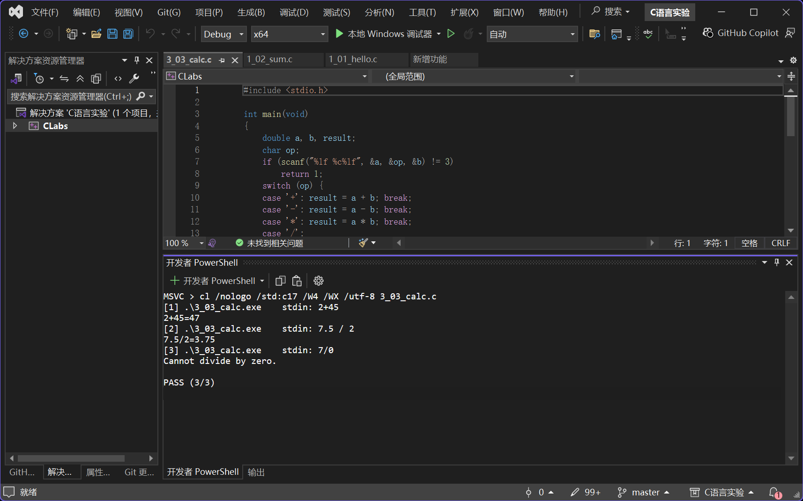

图 3-3  3\_03\_calc.c 的运行截图

### 3.4  DIY 一  改错  三数取最小值

scanf 参数传变量地址。以 a 为当前最小值，依次与 b、c 比较，覆盖 a 居中和数值并列的情况。

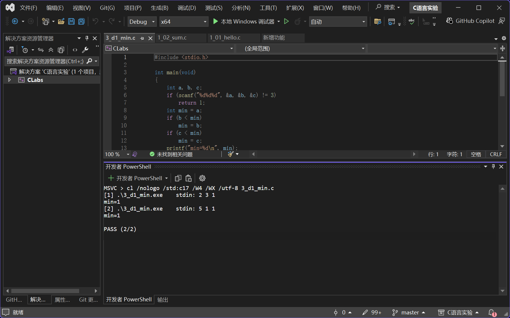

图 3-4  3\_d1\_min.c 的运行截图

### 3.5  DIY 二  填空  判断年月天数

五处依次填 month、闰年条件、28、break、days != 0。世纪年须能被 400 整除才是闰年。

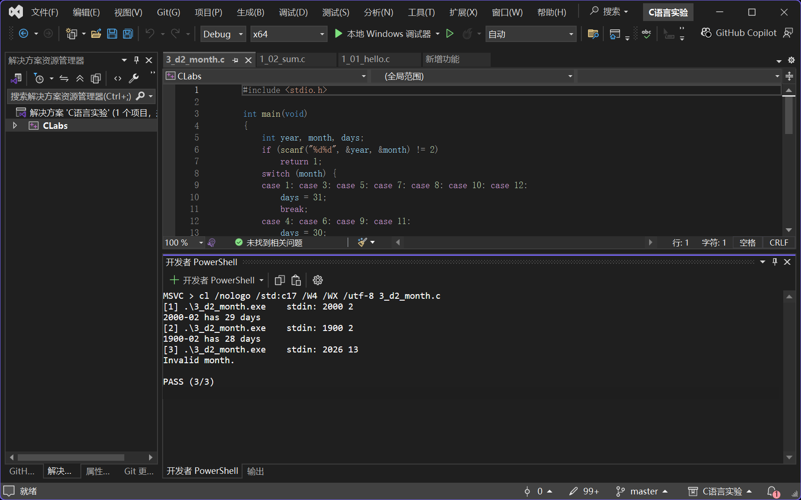

图 3-5  3\_d2\_month.c 的运行截图

### 3.6  DIY 三(1)  5 的倍数、奇偶性与绝对值

同一个输入分别完成三个小问。用余数是否为零做判断，先提升为 long long 再求绝对值。

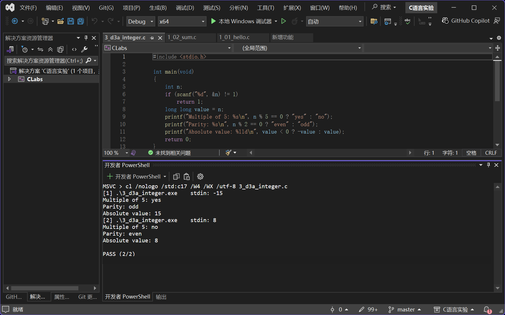

图 3-6  3\_d3a\_integer.c 的运行截图

### 3.7  DIY 三(2)  两数或三数从小到大排列

先读个数 2 或 3，再读取各数。先确保前两项有序，读入三项时再用比较交换定位第三项。

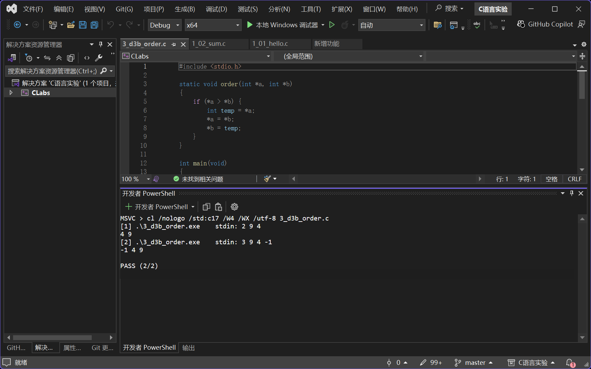

图 3-7  3\_d3b\_order.c 的运行截图

### 3.8  DIY 三(3)  求五个数的最大值

以第一个读入值作为初始最大值，逐项比较，可正确处理五个输入全为负数的情况。

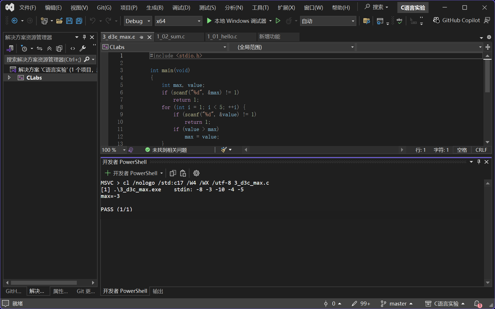

图 3-8  3\_d3c\_max.c 的运行截图

### 3.9  DIY 三(4)  出租车计费

以总行驶里程 3、10 公里为分界，等待费按每 5 分钟折合 1 公里的基本租费（2 元）并按比例折算。合计后四舍五入到元。

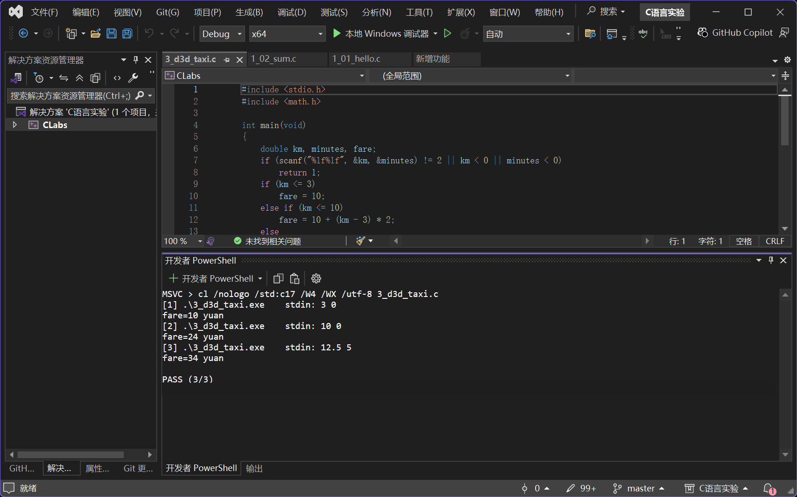

图 3-9  3\_d3d\_taxi.c 的运行截图

### 3.10  DIY 三(5)  百分制成绩分级

先排除 0～100 之外的成绩，再按 90、70、60 的分界从高到低判断。

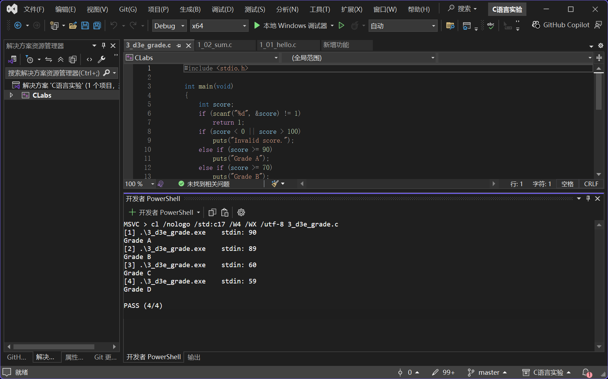

图 3-10  3\_d3e\_grade.c 的运行截图

## 实验四  循环结构程序设计

实验目的  使用 for、while 和 do–while 实现累加、迭代与枚举，练习嵌套循环和分支控制。

实验内容  用 for 循环累加奇数分式，用 while 循环进行辗转相除，并用三层循环枚举 100 元的零钱组合。改错题修正调和级数的累加方式，填空题将 for 求和改为 do–while。编程题按讲义选做三项，各自验证循环条件、步长或迭代结果。

DIY 编程按要求任做三题，选做质数、5 的倍数求和、Fibonacci 数列。

### 4.1  一. 奇数分式求和

令分子 i 从 1 每次增加 2，用 2.0 使除法按浮点数执行。n=5 时，1/3+3/5+5/7 约为 1.65。

图 4-1  4\_01\_series.c 的运行截图

### 4.2  二. 最大公约数和最小公倍数

用辗转相除法迭代更新两数，余数为零时停止。先用原数除以最大公约数再乘另一原数。

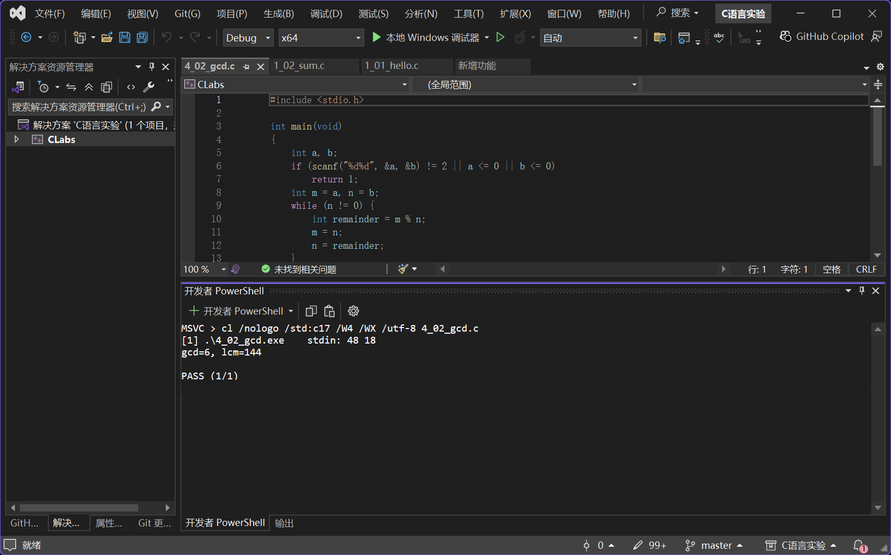

图 4-2  4\_02\_gcd.c 的运行截图

### 4.3  三. 枚举 100 元的换法

10、20、50 元钞票的张数分别遍历 0～10、0～5、0～2。逐组检验总金额并计数，共 10 种。

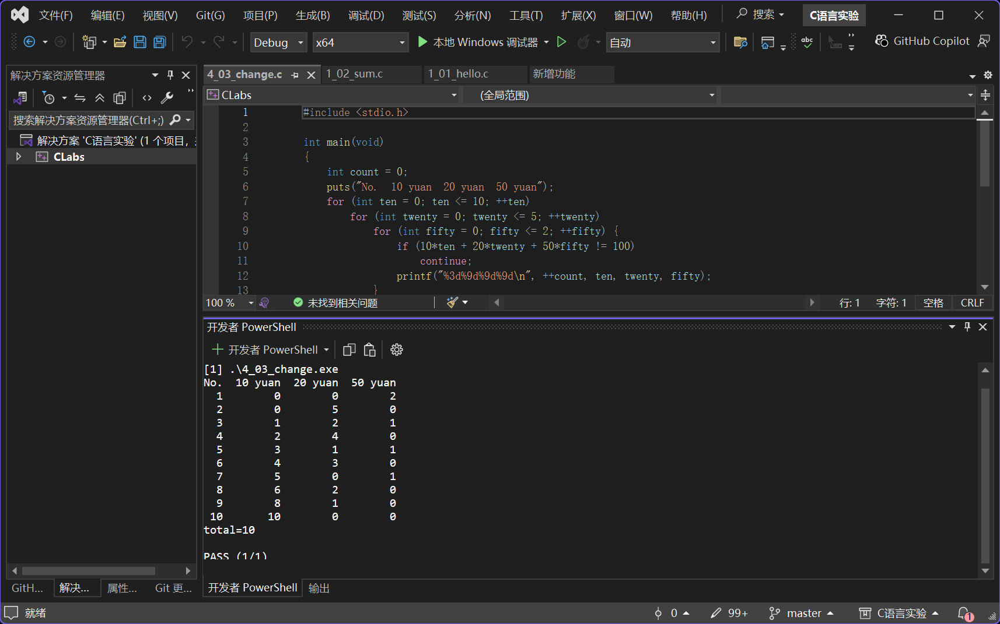

图 4-3  4\_03\_change.c 的运行截图

### 4.4  DIY 一  改错  调和级数求和

将 s 初始化为 0.0，将 1 改成 1.0，并把累加放入循环。n=5 时结果为 2.283333。

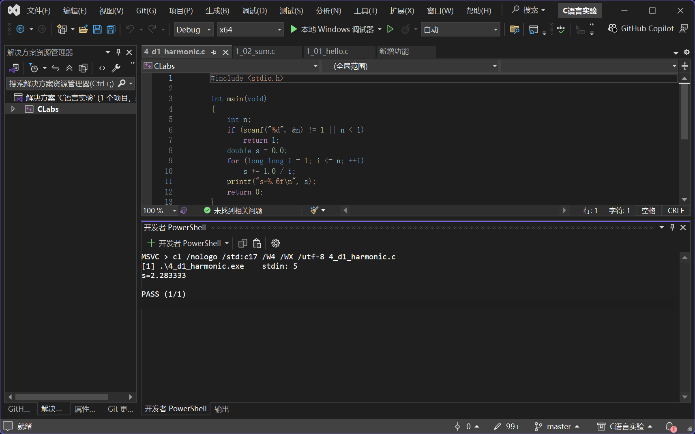

图 4-4  4\_d1\_harmonic.c 的运行截图

### 4.5  DIY 二  填空  将 for 改为 do–while

三处依次填 d=1.0;、++k;、k\<=n，末尾补上分号。首项固定为 1，随后累加 1/(k(k+1))。

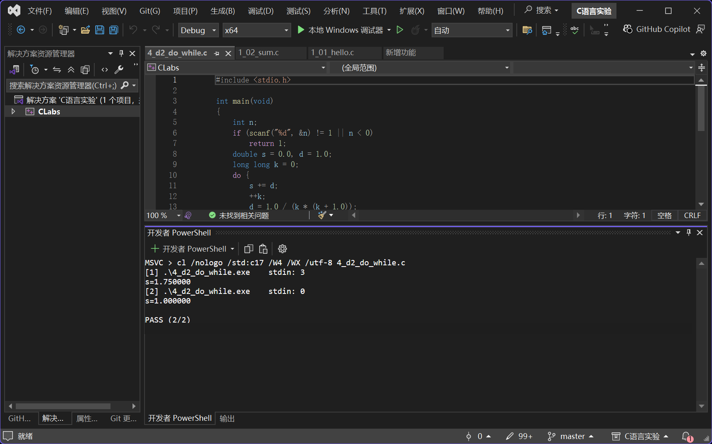

图 4-5  4\_d2\_do\_while.c 的运行截图

### 4.6  DIY 三(1)  两种方法求 2～100 的质数（选做）

分别用试除法和埃氏筛法。试除到平方根，筛法从每个质数的平方开始标记合数。两种结果均为 25 个质数。

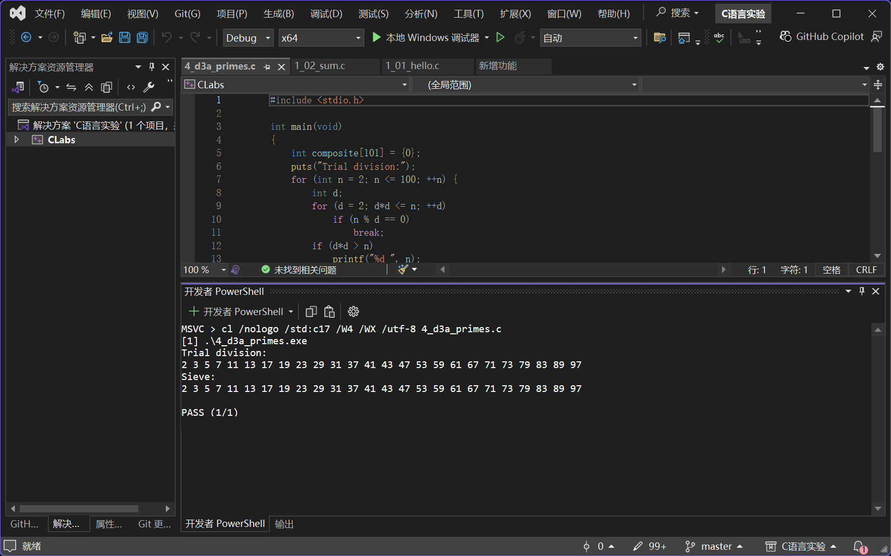

图 4-6  4\_d3a\_primes.c 的运行截图

### 4.7  DIY 三(2)  求 1～100 内 5 的倍数之和（选做）

从 5 起以 5 为步长连续累加到 100，共 20 项，和为 1050。

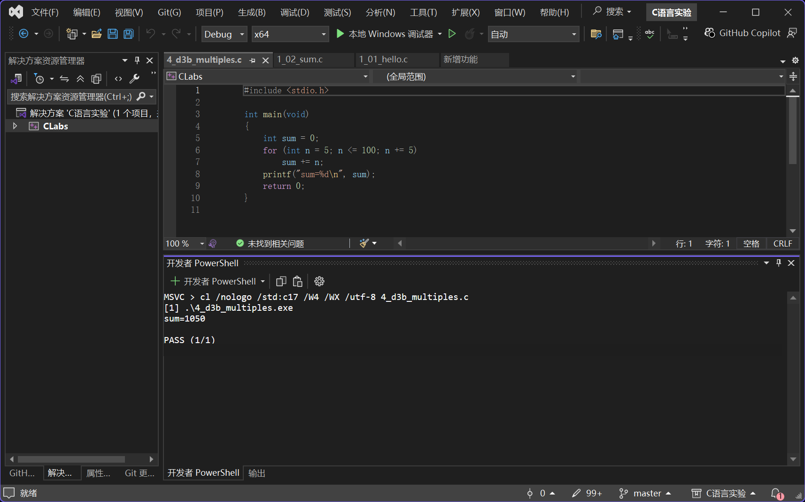

图 4-7  4\_d3b\_multiples.c 的运行截图

### 4.8  DIY 三(5)  打印前 20 项 Fibonacci 数列（选做）

保存相邻两项，滚动更新。每输出 5 项换行，第 20 项为 6765。

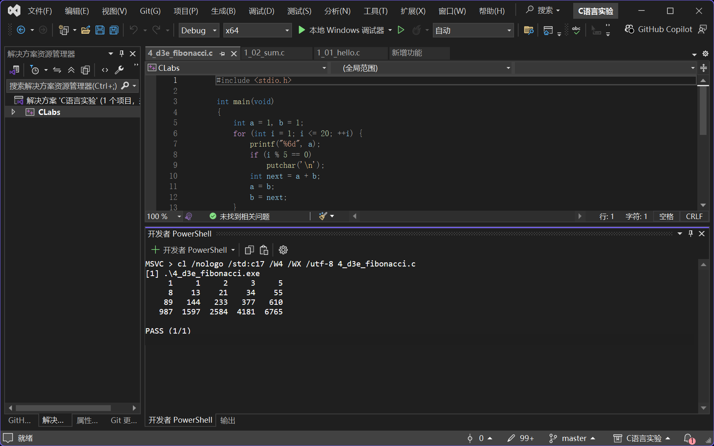

图 4-8  4\_d3e\_fibonacci.c 的运行截图

## 实验五  数组的定义及其应用

实验目的  定义和使用一维、二维及字符数组，练习成绩统计、有序插入、字符串处理与矩阵判断。

实验内容  用一维数组存储十个成绩，计算总分、平均分和最高最低分。向升序数组插入整数，比较插入前后的顺序。用字符数组实现拼接、拷贝、有序插入和字符分类计数，再用二维数组逐对比较主对角线两侧的元素，验证矩阵是否对称。

### 5.1  一. 计算十名同学的总分和平均分

用数组记录十个分数，读入时累加，总分除以 10.0 得平均分。

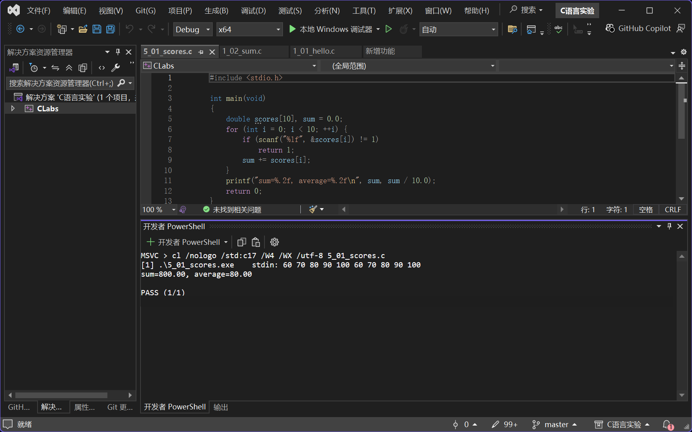

图 5-1  5\_01\_scores.c 的运行截图

### 5.2  二. 向固定有序数组中插入整数

从数组尾部移动大于新值的元素，为新值留出位置，支持在首位与末尾插入。

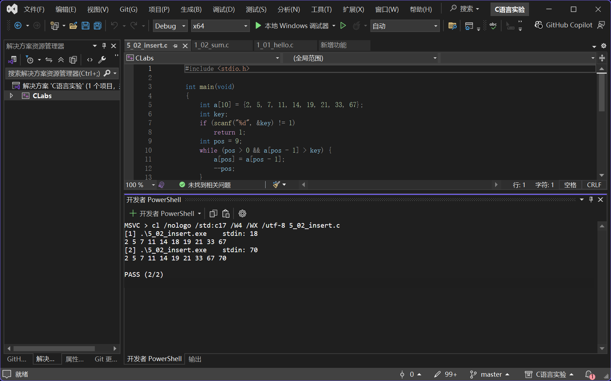

图 5-2  5\_02\_insert.c 的运行截图

### 5.3  三. 使用下标拼接两个字符串

用 fgets 读取整行，去掉换行。将 str2 逐字符复制到 str1 原来的终止位置后，并重新写入终止符。

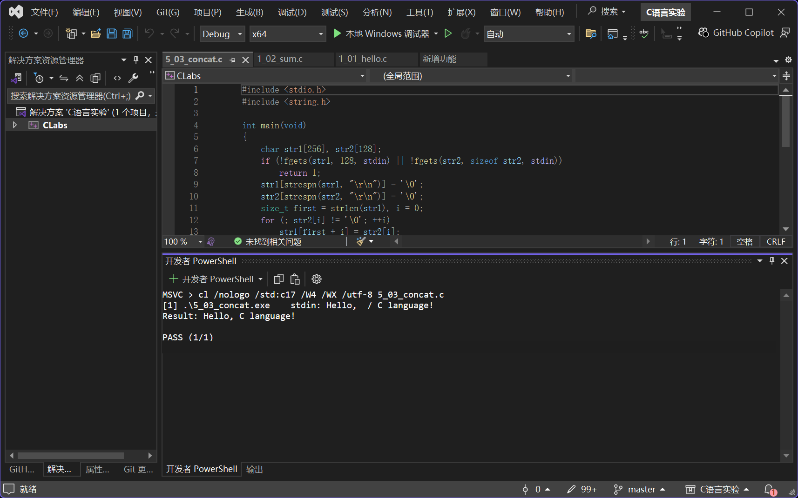

图 5-3  5\_03\_concat.c 的运行截图

### 5.4  DIY 一  改错  向输入的递增数列插入整数

scanf 使用 &a[i] 和 %d，printf 输出元素值。后移从合法的最后一个下标 10 开始，避免读取 a[−1] 或写入 a[11]。

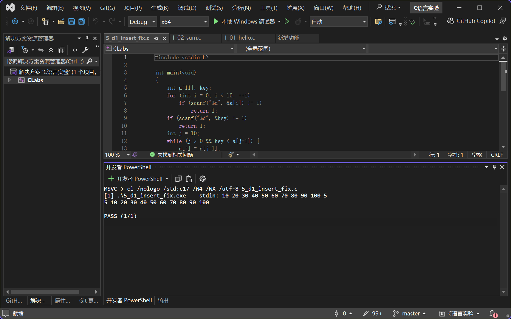

图 5-4  5\_d1\_insert\_fix.c 的运行截图

### 5.5  DIY 二  填空  按升序插入字符

循环头为 i=(int)strlen(a); i\>=j; --i，循环体为 a[i+1]=a[i]，puts 参数为 a。每次连同终止符一起向右移动，再写入 a[j]。

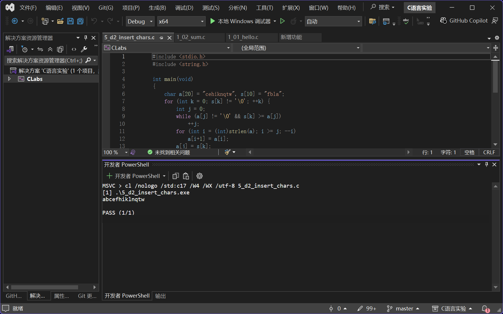

图 5-5  5\_d2\_insert\_chars.c 的运行截图

### 5.6  DIY 三(1)  求最高分和最低分

读入十个成绩。用首项初始化最高分和最低分，从第二项起分别更新。

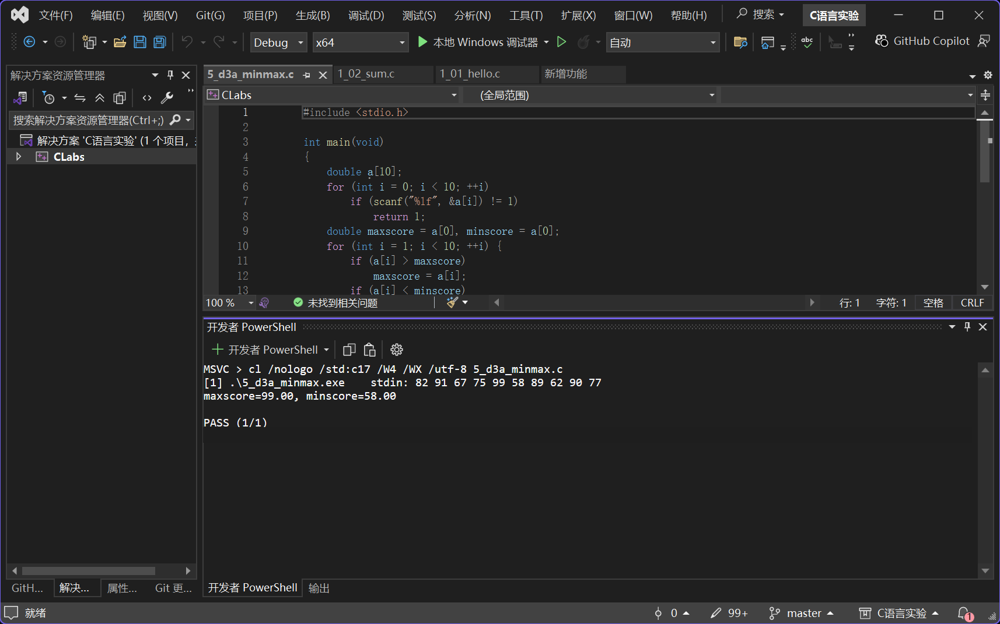

图 5-6  5\_d3a\_minmax.c 的运行截图

### 5.7  DIY 三(2.1)  统计一行字符

用 fgets 保留空格，遍历到换行或终止符为止，分别统计大写、小写、空格、数字与其他字符。

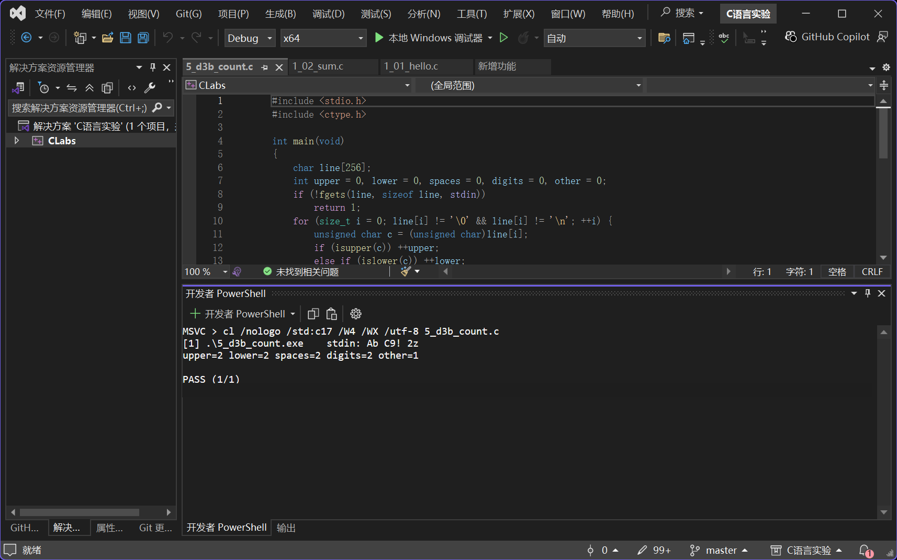

图 5-7  5\_d3b\_count.c 的运行截图

### 5.8  DIY 三(2.2)  实现字符串拷贝

strcopy(dest, src) 逐个复制，包括最后的终止符。目标数组容量与来源缓冲区相同。

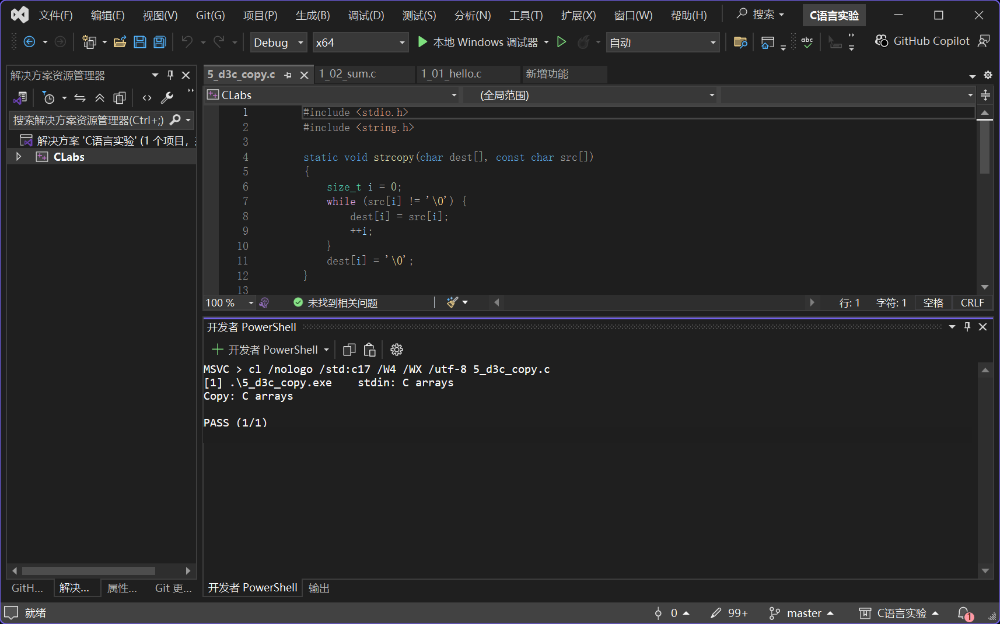

图 5-8  5\_d3c\_copy.c 的运行截图

### 5.9  DIY 三(3)  判断三阶矩阵是否对称

检查主对角线上方的三个元素与相应下方元素是否相等。任一对不等即判定为非对称矩阵。

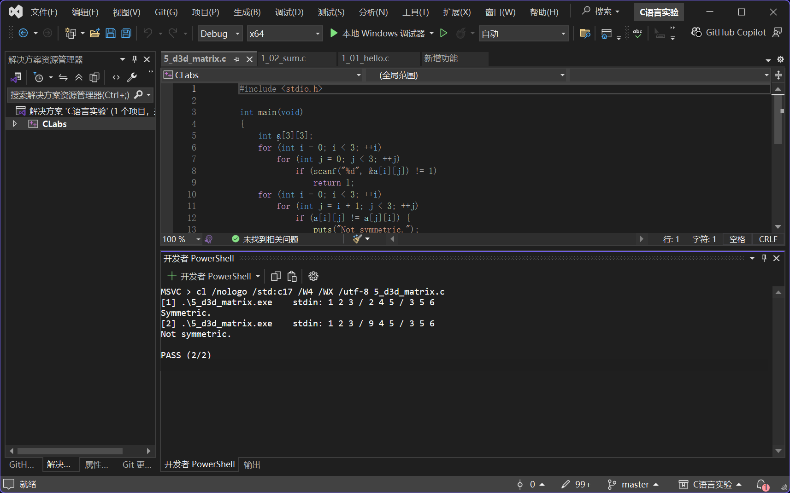

图 5-9  5\_d3d\_matrix.c 的运行截图

## 实验六  函数的定义及其应用

实验目的  定义和调用函数，向子函数传入数组及长度，明确递归边界和变量作用域。

实验内容  由主函数读取数据并调用子函数。排序题把数组和元素个数交给排序函数，输出排序前后的序列。组合数题分别用递归阶乘和递推关系验证结果。其余练习用递归逐位倒序输出整数、计算字符串长度，并用独立函数将十六进制数转换为十进制。

### 6.1  一. 使用子函数对 n 个整数排序

main 负责输入输出，fun 接收数组与元素个数并进行选择排序。每轮从未排序部分找到最小值，再与当前位置交换。

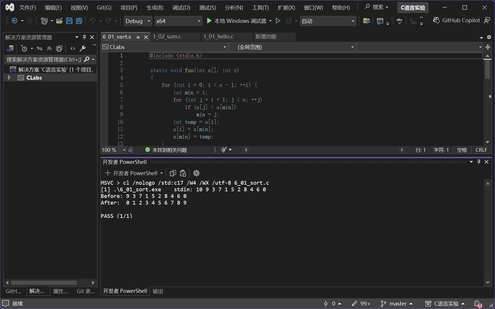

图 6-1  6\_01\_sort.c 的运行截图

### 6.2  二. 用递归阶乘求组合数

用 fac(n) 递归计算阶乘，0! 和 1! 均为 1。按例题需要可交换 m 与 n；将输入限定在 0～20，分母是两个阶乘的乘积。

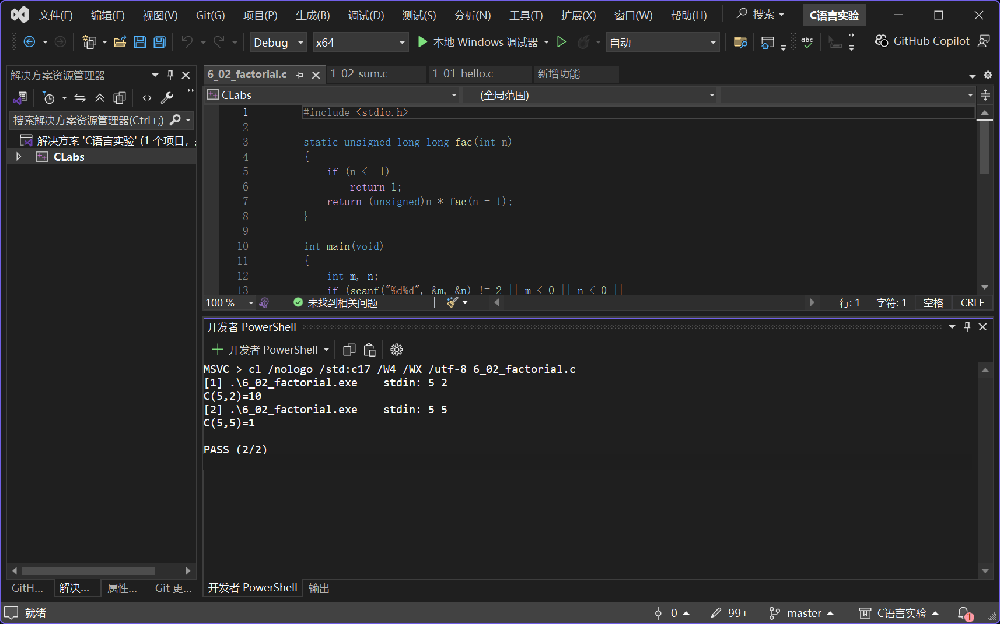

图 6-2  6\_02\_factorial.c 的运行截图

### 6.3  DIY 一  改错  用组合数递推公式

修正终止条件，k=0 或 k=n 时返回 1，越界时返回 0。printf 接收 A(n,k) 的返回值。朴素递归用小规模输入演示。

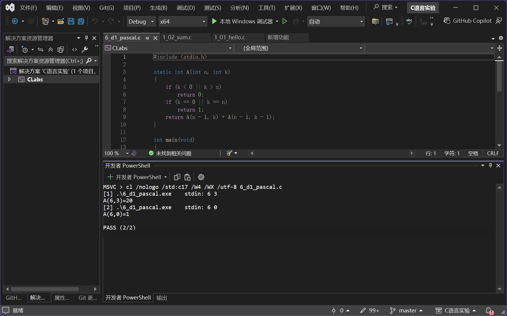

图 6-3  6\_d1\_pascal.c 的运行截图

### 6.4  DIY 二  填空  递归倒序输出正整数

五处依次填 m%10、m/10、m!=0、r(m)、&n。每次先输出个位，再递归处理剩下的高位。

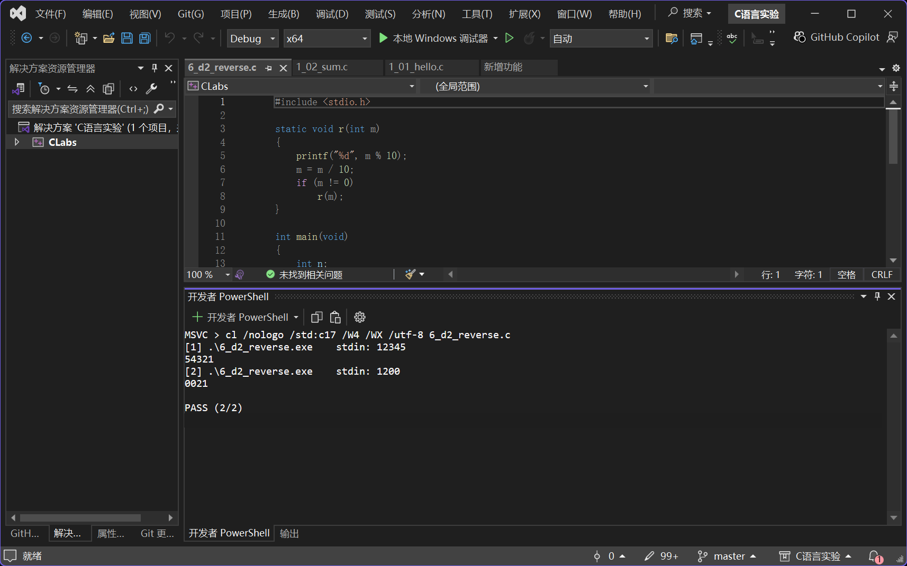

图 6-4  6\_d2\_reverse.c 的运行截图

### 6.5  DIY 三(1)  十六进制转换为十进制

依次将每个字符换算为数值，执行当前值 ×16+新位；支持大小写和 0x 前缀，并检查溢出。

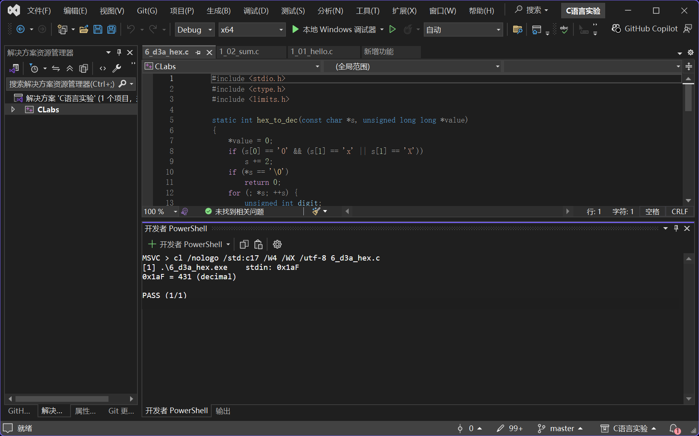

图 6-5  6\_d3a\_hex.c 的运行截图

### 6.6  DIY 三(2)  递归计算字符串长度

遇到终止符返回 0，其余位置返回 1 加上后续字符串的长度，空串长度为 0。按 C 字符串字节计数。

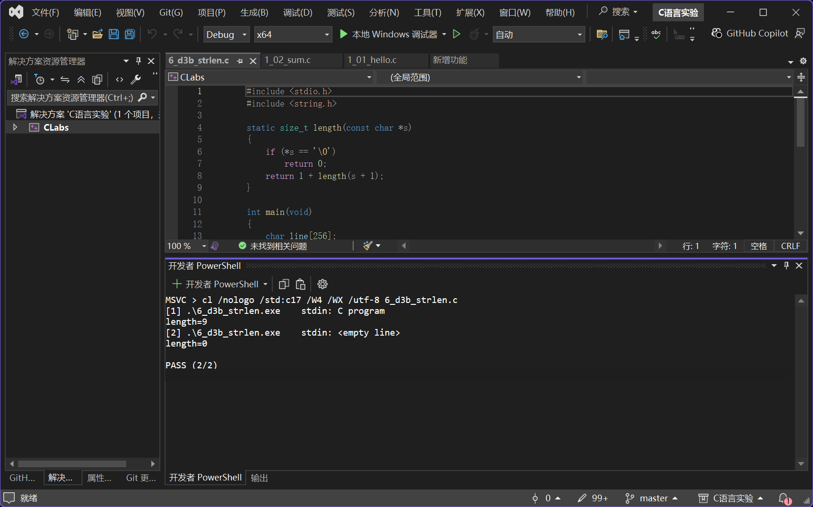

图 6-6  6\_d3b\_strlen.c 的运行截图

## 实验七  指针的定义及其应用

实验目的  使用取地址与解引用、指针运算、指针参数和动态内存分配，处理数组及字符串。

实验内容  根据输入的元素个数动态申请数组，用指针逐项读取并求和，使用完毕后释放内存。将两个变量的地址传给交换函数，比较调用前后的值。用读写指针完成字符串连接和反转，并逆置整数数组。选做题通过指针访问数据，完成整数四则运算、数组求和、回文判断和动态成绩统计。

### 7.1  一. 动态分配整数数组并求和

calloc 按输入的 n 分配空间，检查分配结果。使用 p+i 读取，使用 \*(p+i) 取值。循环执行 n 次，最后释放空间。

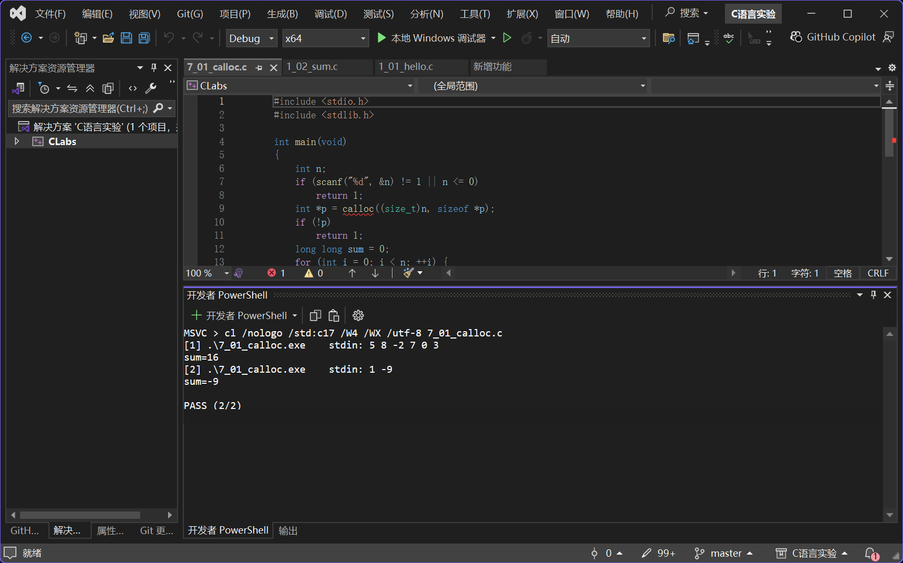

图 7-1  7\_01\_calloc.c 的运行截图

### 7.2  二. 通过指针交换两个变量的值

向 swap 传入 a、b 的地址。解引用后写入指针指向的位置，因此主函数中的两个值完成交换。

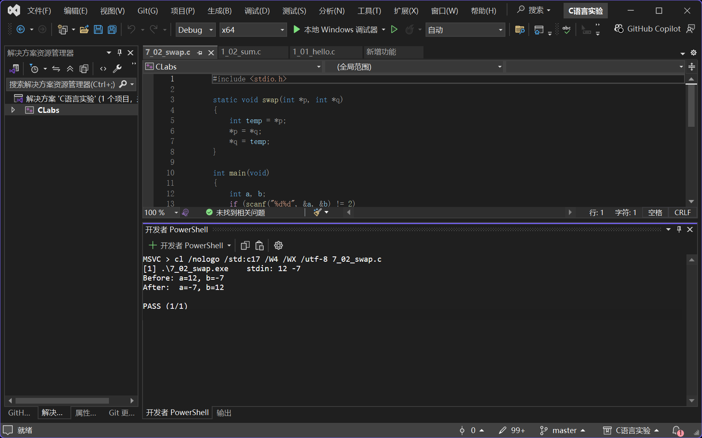

图 7-2  7\_02\_swap.c 的运行截图

### 7.3  三. 通过指针连接字符串

令写指针指向 str1 的终止符，读指针遍历 str2，复制完毕后补上终止符。这样首串为空时也可正常工作。

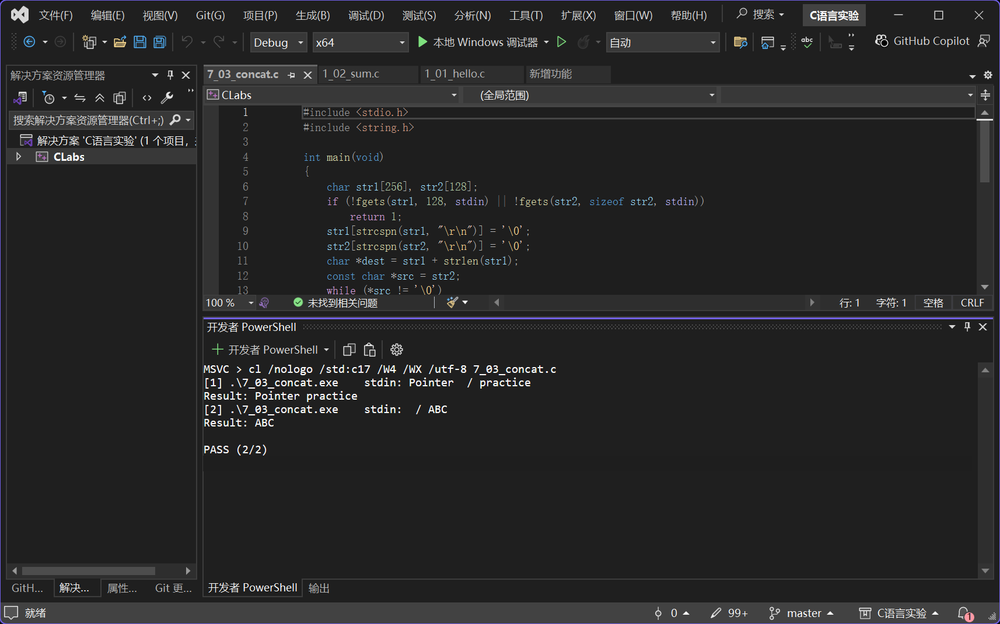

图 7-3  7\_03\_concat.c 的运行截图

### 7.4  DIY 一  改错  使用指针反转字符串

用现代 C 的函数声明。空串直接返回，避免指针退到数组起点前；非空串由首尾两端向中间交换。

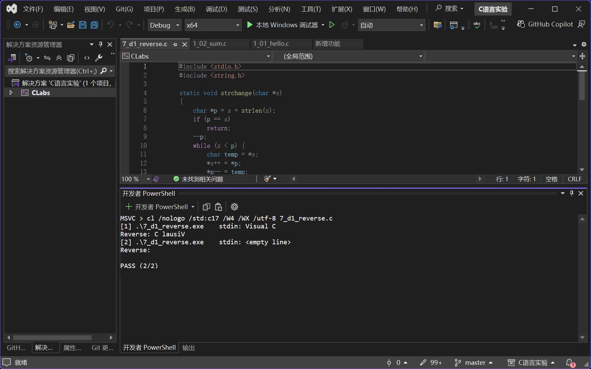

图 7-4  7\_d1\_reverse.c 的运行截图

### 7.5  DIY 二  填空  用指针逆置数组

三处依次填 s\<t、++s、--t。第二参数是末项下标 n−1；两个指针相遇或交错时停止。

图 7-5  7\_d2\_invert.c 的运行截图

### 7.6  DIY 三(1)  用 int 指针完成四则运算（选做）

用两个指向 int 的指针访问操作数。先提升为 long long 计算，整数除法分支检查除数。

图 7-6  7\_d3a\_pointer\_math.c 的运行截图

### 7.7  DIY 三(2)  用指向数组的指针求和（选做）

声明 int (\*p)[5] 并令其指向整个数组。用 (\*p)[i] 访问各元素并累加。

图 7-7  7\_d3b\_pointer\_array.c 的运行截图

### 7.8  DIY 三(3)  使用指针判断回文（选做）

从首尾两端逐对比较字符，比较区分大小写并保留输入中的空格。

图 7-8  7\_d3c\_palindrome.c 的运行截图

### 7.9  DIY 三(4)  动态分配并统计成绩（选做）

输入人数后动态分配成绩数组。读取所有分数后计算总和与极值，最后释放数组。

图 7-9  7\_d3d\_dynamic\_scores.c 的运行截图
