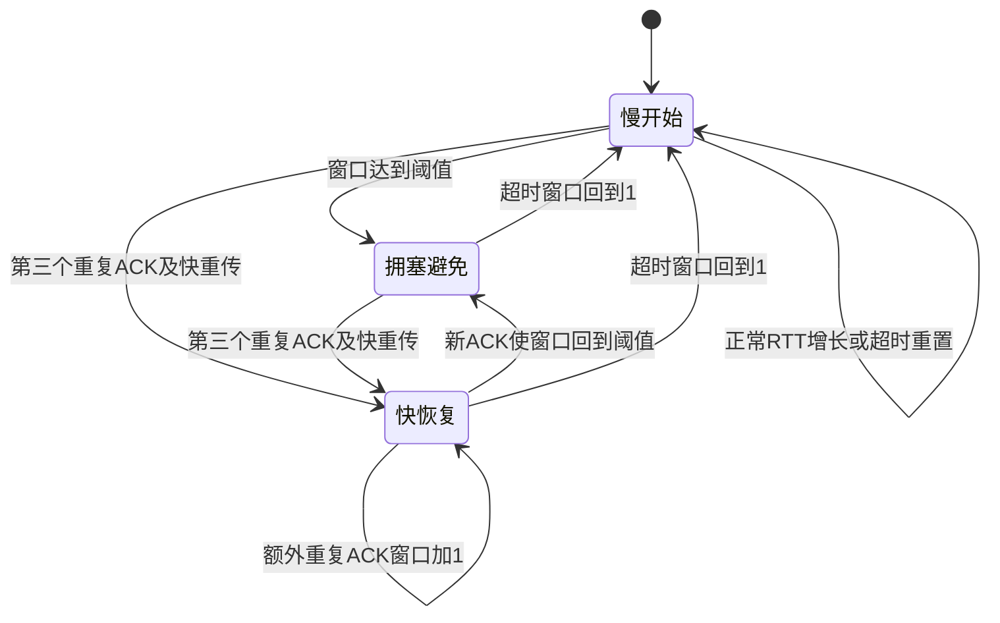

# 模型与复现说明

[返回项目首页](../README.md)

## 状态关系

快重传是进入快恢复时触发的一次动作，持续状态由慢开始、拥塞避免和快恢复表示。

## 规则与边界

初始窗口为 1 MSS，默认阈值为 64 MSS。按 RTT 近似时，慢开始翻倍至阈值，拥塞避免每轮加 1。
第三个重复 ACK 触发阈值减半（最低为 2）；课程模式窗口取新阈值，标准对照入口额外增加 3 MSS。
额外重复 ACK 增加窗口，新 ACK 使窗口回到阈值并退出快恢复；超时使窗口回到 1。

标准对照仅比较快恢复入口，不是完整 TCP 协议栈。模型假设有足量待发数据，以窗口近似在途量，省略真实数据包、接收窗口、延迟 ACK、SACK 与自适应 RTO。
`Record.rtt` 是抽象仿真步进，不是墙钟时间或抓包时间。公开仓库保留算法计数逻辑，不携带原运行轨迹。

## 数据生成与绘图

`run_experiments.py` 在本机生成预设 CSV，以及多个种子的随机实验汇总。
`plot_comparison.py` 读取本机生成的 CSV，输出三种事件概率下的窗口比较 SVG。
这些生成目录受项目 `.gitignore` 排除。原截图和原逐步记录不在公开版中。

固定种子可用于复现同一模型的行为；单个种子轨迹不代替多种子统计。运行测试请按首页命令执行。
