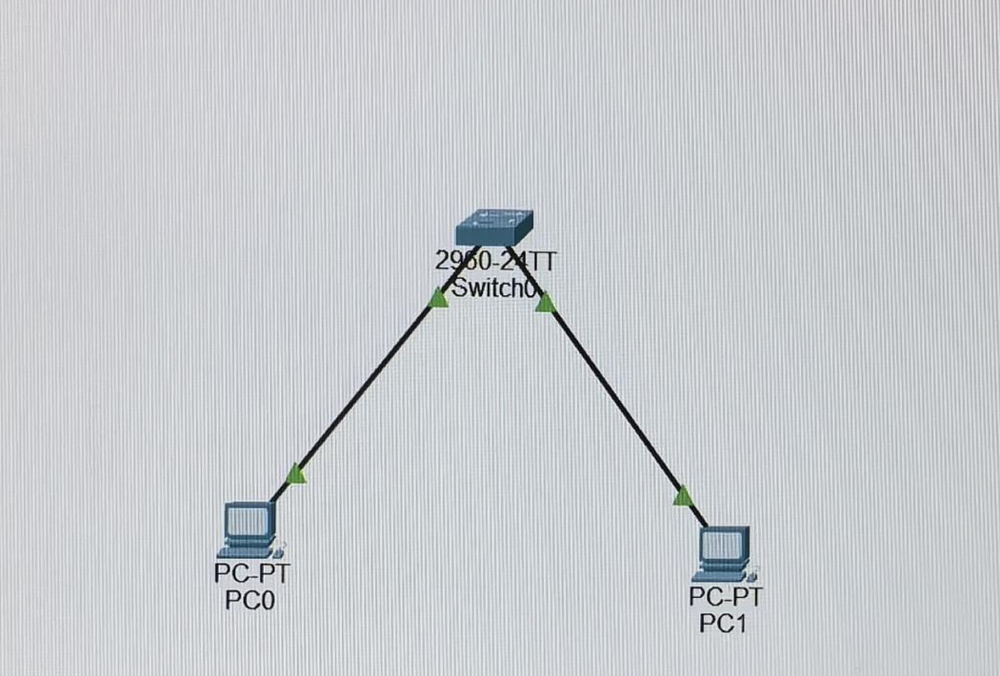
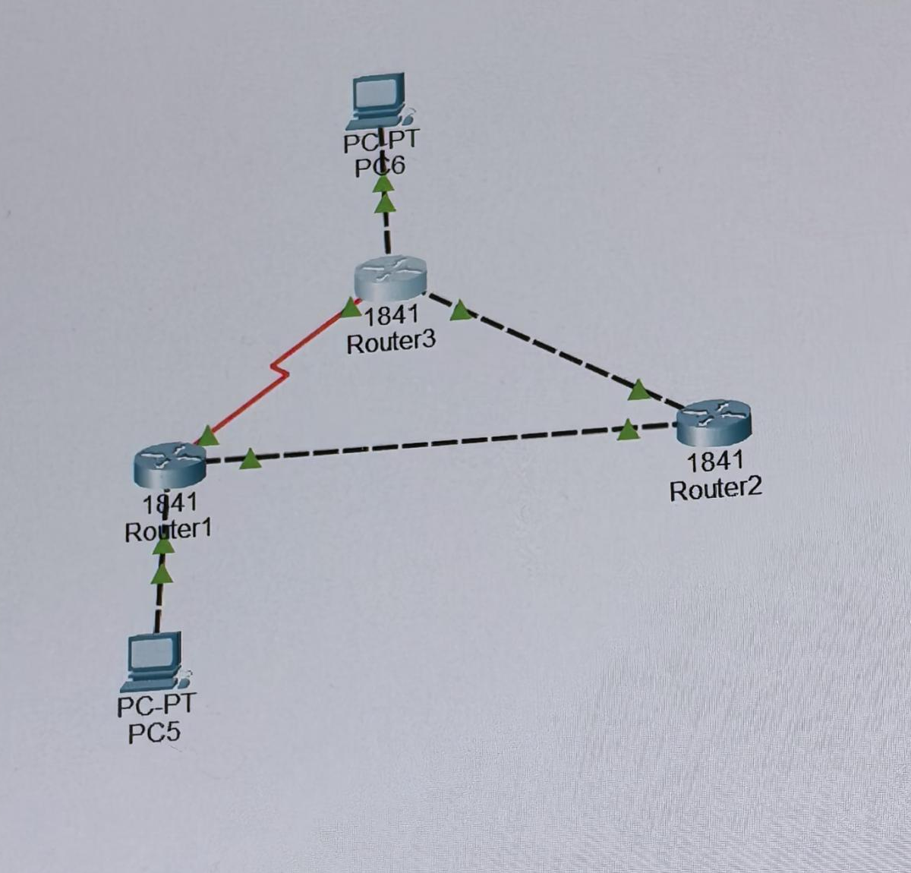

# 计算机网络实验报告

[返回实验目录](README.md) · [返回计算机网络目录](../readme.md)

本报告整理网络命令、局域网与静态路由、RIP、Wireshark 协议分析四个实验，重点记录操作思路、遇到的问题和结果解释。

公开版不展示个人身份、具体网络地址、端口、抓包编号和时间记录，仅附经检查不含这些信息的原始拓扑图。相关内容已改写为通用描述，正文不再逐项插入删除标记。

## 阅读约定

命令中的大写名称是需要替换的参数。例如，`TARGET_HOST` 表示实验目标主机，`GATEWAY` 表示本机默认网关，`PROCESS_ID` 表示实际查询到的进程编号。它们不是原实验值，不能原样执行。

## 实验一 网络命令的使用

### 实验目的与环境

在 Windows 命令提示符中使用常见网络命令，检查连通性、连接状态、地址配置与 ARP 映射，并理解不同命令分别能验证什么。

### 实验过程

#### 连通性与域名解析

先测试本机回环通信，再测试同网段主机，最后访问外部主机或域名。按这个顺序，可以逐步区分本机协议栈、局域网连接与外部访问的问题。

```text
ping LOOPBACK_HOST
ping TARGET_HOST
ping TARGET_DOMAIN
```

回环测试成功，只能说明本机的回环处理正常，不能替代局域网验证。域名能够解析且收到应答，则说明本次解析和到目标地址的 ICMP 通信正常。

随后分别调整请求次数和初始 TTL，比较命令行为：

```text
ping -n REQUEST_COUNT TARGET_HOST
ping -i INITIAL_TTL TARGET_HOST
tracert TARGET_HOST
```

`-n` 设置请求次数，`-i` 设置请求报文的初始 TTL。应答中显示的 TTL 属于返回报文，不能直接当作请求报文的初始 TTL。路径跟踪中出现星号，表示某次探测未及时收到回应；如果后续仍能到达目标，就不能据此认定目标不可达。

实验中曾把参数与域名连写。补上空格后命令恢复正常，因此排错时应先检查输入格式。

#### 连接状态与进程

```text
netstat -e
netstat -ano
tasklist /fi "PID eq PROCESS_ID"
```

先观察接口统计，再查询活动连接和监听状态，最后根据进程编号定位程序。

| 观察内容 | 解释 |
| --- | --- |
| ESTABLISHED | 连接已建立 |
| CLOSE_WAIT | 已收到对端关闭请求，等待本地应用关闭 |
| 接口错误与丢弃计数 | 接口累计统计，需要结合观察时段理解 |
| 本地与远端端口 | 必须区分方向，不能把远端端口当成本机监听端口 |

#### 地址配置与 DHCP

```text
ipconfig /all
ipconfig /release
```

核对本机地址、子网掩码、默认网关、DNS 和 DHCP 状态，并判断网关是否与本机处于同一子网。

原实验中，释放地址的操作失败。结合配置可知，该网卡使用静态地址，未启用 DHCP，不能按 DHCP 租约释放。这个提示不代表原静态配置失效。

#### ARP 缓存

```text
arp -a
arp -d TARGET_HOST
ping TARGET_HOST
arp -a
```

先查看缓存，再删除目标条目并重新通信，观察动态映射是否出现。原报告记录了删除缓存后重新通信成功的过程。

同网段通信需要目标主机的 MAC；跨网段通信通常需要下一跳网关的 MAC。ARP 表中的普通主机动态映射与广播、组播静态映射应分别理解。

### 实验结论

网络排错需要把命令输出和协议层次对应起来：回环通信检查本机处理，地址与掩码决定是否同网段，网关影响跨网段转发，ARP 负责本链路的地址映射。命令输入错误和静态配置限制，应先于更复杂的故障假设排查。

## 实验二 使用Packet Tracer模拟网络环境

### 实验目的与环境

使用 Packet Tracer 搭建交换机局域网和双路由器网络，理解地址、掩码、网关与双向路由的作用。

### 同一局域网通信



*图一：交换机连接两台 PC 的原始拓扑，已裁去无关界面，只保留原图中的设备及连接。*

将两台 PC 接入同一交换机，配置属于同一子网的主机地址与掩码，再互相测试连通性。

原实验中，一台 PC 的地址误填到了另一个网段，测试命令也曾漏写目标地址的一部分。纠正地址配置和命令输入后，两台 PC 可以通过交换机互通。

这一任务的拓扑没有路由器，同网段通信不依赖默认网关。交换机学习源 MAC，并根据目的 MAC 选择转发出口；不能把交换机的转发方式理解成集线器向其他端口重复比特。

### 跨局域网通信

两个局域网分别连接一台路由器，两台路由器通过互联链路相连。

| 配置位置 | 检查重点 |
| --- | --- |
| PC | 地址与掩码匹配所在局域网，网关指向本地路由器 |
| 路由器局域网接口 | 与本地 PC 处于同一子网，接口已启用 |
| 路由器互联接口 | 两端属于同一互联网络，链路状态正常 |
| 路由表 | 包含到远端局域网的路径，并具备回程路由 |

接口配置完成后，分别添加到远端局域网的静态路由。命令结构如下，其中目标网络、掩码和下一跳需要按自己的拓扑填写：

```text
ip route REMOTE_NETWORK SUBNET_MASK NEXT_HOP
```

只有直连路由时，路由器还不知道远端局域网的路径。静态路由需要同时考虑请求和应答：去程可达而回程缺失，也无法完成双向通信。

### 测试与排错

从源 PC 测试远端 PC，依次检查：

- 目标地址和命令是否输入完整。
- 源 PC 能否到达本地网关。
- 两台路由器的互联接口是否启用，地址是否匹配。
- 两端是否都具有正确的远端路由。

原报告曾记录目标不可达和超时，最终重复测试成功。早期超时不能一概解释成 ARP 学习，应结合实际地址、接口和路由配置判断。

### 实验结论

地址与掩码决定是否同网段。同网段通信由交换机完成帧转发；跨网段通信还需要正确网关、可用的路由器接口和双向路由。

## 实验三 使用Packet Tracer模拟路由协议

### 实验目的与拓扑

使用三台路由器组成三角形网络，两端接入不同局域网。路由器之间同时存在串行直连路径和经过中间路由器的路径，用于观察 RIP 路由学习及跳数度量。



*图二：三路由器及两端 PC 的原始拓扑，已裁去计时栏和无关界面，设备及连接保持原样。*

### 接口与 RIP 配置

先完成各接口的地址配置并启用接口，串行链路的 DCE 端提供时钟。确认接口工作正常后，进入 RIP 配置，将各自的直连网络加入路由通告。

原工程没有显式设置 RIP 的版本，本报告不把它改写成已经验证过的另一种版本配置。

串行电缆的线条颜色不能单独作为故障依据，应结合接口状态标记、配置与通信测试判断链路是否可用。

### 路由学习与选路

在 Simulation 模式中观察 RIP 与 ICMP 事件，再结合路由表分析收敛结果：

```text
show ip route
```

路由表最初只有直连信息，完成 RIP 配置后出现远端网络路由。直连标识与 RIP 学习标识表示不同的路由来源。

原实验记录表明，两端 PC 能够互通；仿真事件显示，报文选择了路由器之间跳数更少的串行路径，而没有绕行中间路由器。RIP 使用跳数度量，不直接根据带宽或时延选择路径，因此较低速率的直连路径仍可能被选中。

### 等价路径的证据与边界

中间路由器的路由表同时保留了到同一目的网段的等价下一跳，说明具备等价多路径转发的路由条件。

但路由表存在多个下一跳，不代表每次测试都严格交替使用不同接口。逐包路径还需结合实际仿真事件判断。

原报告尚缺少这部分完整的运行截图与逐包路径记录，因此本版保留“路由表条件已观察到，实际负载分配仍待补充验证”的结论。

### 实验结论

RIP 能够通过交换路由信息学习非直连网络。分析选路时，应区分路由表中的候选路径与某一次报文实际走过的路径，不能仅凭多个下一跳就声称完成了逐包负载均衡验证。

## 实验四 Wireshark抓包分析

### 实验目的与环境

使用 Windows、Wireshark、命令提示符和 curl，观察 ICMP 请求应答，以及同一 TCP 连接的建立、数据传输和释放过程。

### ICMP 捕获与地址核对

选择实际联网的接口，在开始捕获前限定目标流量，再向实验目标发起 ping。

捕获过滤器的结构为：

```text
icmp and host TARGET_HOST
```

停止捕获后，按请求与应答配对，核对报文类型、标识符、序号和方向，并结合本机配置与 ARP 表检查地址对应关系：

```text
ipconfig /all
arp -a TARGET_HOST
```

请求与应答的标识符及序号对应，源与目的地址方向相反。结合本机配置和网关映射，可以把网络层地址与链路层地址对应起来。

抓包时间戳计算的时间差，与 ping 命令的计时位置和显示精度不同，不能要求二者逐项完全一致。本版不公开原始时间值。

### 定位同一条 TCP 连接

通过 HTTP 请求产生 TCP 流量，并要求响应结束后关闭连接，便于观察连接释放。系统同时存在物理网卡与虚拟接口，因此分析前先选定一条完整 TCP 流：

```text
tcp.stream == STREAM_ID
```

这里的 `STREAM_ID` 需要替换为当前捕获中的目标流编号。握手、传输和挥手必须围绕同一条连接分析，不能拼接不同接口或不同流的报文。

关闭应用层显式代理，也不能据此证明整个系统网络路径完全不经过代理。

### 三次握手与数据传输

| 阶段 | 方向 | 作用 |
| --- | --- | --- |
| SYN | 客户端到服务器 | 请求建立连接，声明初始序号 |
| SYN 与 ACK | 服务器到客户端 | 确认客户端请求，声明服务器初始序号 |
| ACK | 客户端到服务器 | 确认服务器的初始序号 |

SYN 占用一个序号，因此对 SYN 的确认需要在对端初始序号上加一。Wireshark 显示的相对序号，不能当作报文中的原始序号。

数据传输阶段，根据有效载荷长度检查序号推进，再核对累计确认号。确认号表示期望收到的下一字节；分析 HTTP 响应时，还要区分应用正文长度与包含应用头部的 TCP 数据长度。

### 连接释放与异常现象

原报告选取的连接由服务器先关闭发送方向，随后客户端确认并关闭自己的发送方向，最后由服务器确认。

FIN 与 SYN 一样占用一个序号，因此确认 FIN 后，期望序号也要向前推进。实际抓包中可能夹有重传与重复确认，释放连接的关键报文不一定连续排列。

原实验还观察到 FIN 重传和正常关闭之后出现的 RST。仅凭一次抓包不能确定重传的确切成因；后续 RST 应单独分析，不能替代正常关闭过程中的确认报文，也不能只凭 RST 和窗口字段认定是流量控制。

### 实验结论

原报告记录了 ICMP 请求应答，以及同一 TCP 流的完整建立与释放过程。分析时，先确认接口和连接，再结合方向、标志位、序号及确认号判断报文作用，比只看某一列信息更可靠。

## 总结

这组实验从命令检查、网络配置推进到动态路由和协议分析。排错时，我需要先核对输入和基础配置，再用路由表、仿真事件或报文字段支持判断。

公开版保留操作方法、观察结果和分析边界。未完成的验证仍明确标出，具体网络环境及原始实验记录不在本报告中展示。
