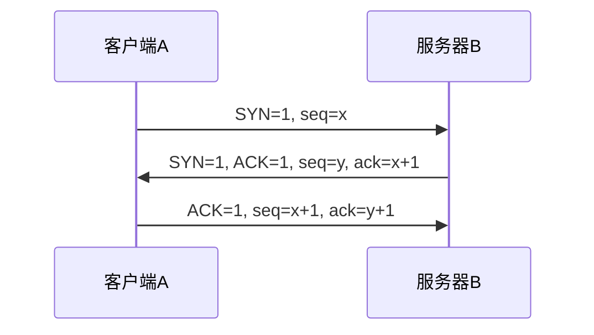
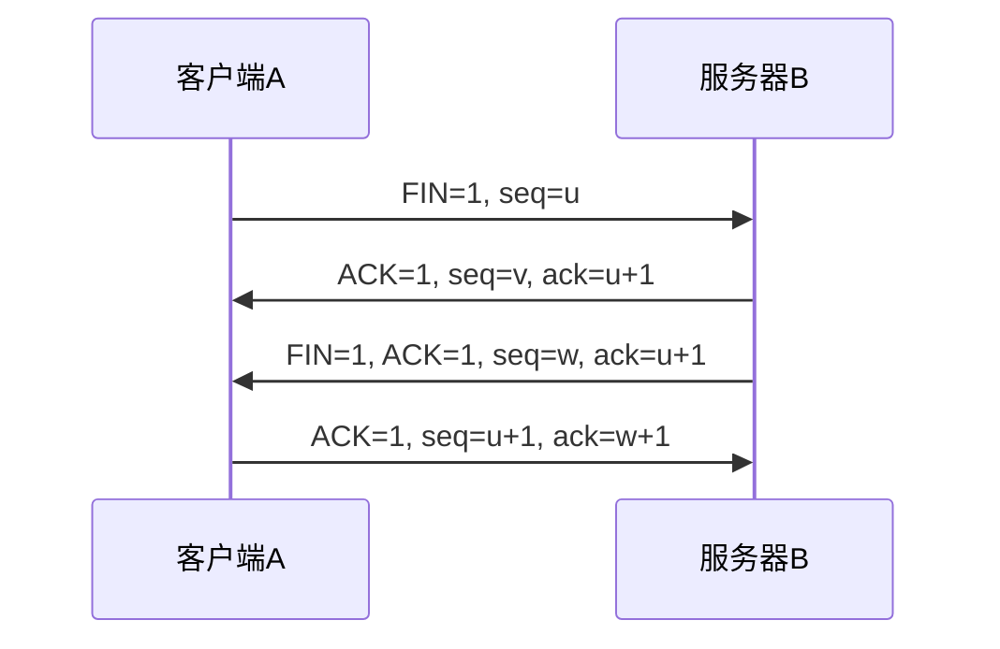

# 计算机网络：前6章图文精简笔记

[返回计算机网络目录](../readme.md)

> 公开脱敏版：已删除个人身份与学校信息、所有具体网络地址、MAC 和端口数值；不附原截图。保留协议概念、理论公式和不涉及网络标识的计算参数。

## 目录

- [第1章概述](#第1章概述)
- [第2章物理层](#第2章物理层)
- [第3章数据链路层](#第3章数据链路层)
- [第4章网络层](#第4章网络层)
- [第5章传输层](#第5章传输层)
- [第6章应用层](#第6章应用层)

## 第1章概述

### 定义、组成与分类

主线：把独立计算机连起来，按照协议通信并共享资源。

网络由什么组成？

网络边缘的主机、服务器产生和接收数据；网络核心的路由器与链路负责分组转发。

两大功能：数据通信、资源共享（硬件 / 软件 / 数据）。
发展脉络：ARPANET → 主干网、地区网、校园网的三级结构 → 多层次ISP互联。ISP即因特网服务提供者。

| 分类依据 | 要记的类型 |
| --- | --- |
| 覆盖范围 | PAN个域网 → LAN局域网 → MAN城域网 → WAN广域网 |
| 使用者 / 拓扑 | 公用网、专用网 / 总线、星形、环形、树形、网状 |
| 交换技术 | 电路交换、报文交换、分组交换 |

分清两个词
Internet是全球互联网络；WWW（万维网）是运行在其上的一种应用。

> 对应课件第3、6-10页 · 页码按原PDF顺序

### 三种交换与分层术语

交换解决“数据怎么走”；分层让每一层各司其职。

| 方式 | 怎样传 | 主要特点 |
| --- | --- | --- |
| 电路交换 | 先建立专用通路，再传数据 | 带宽预留；建立连接有开销；传输阶段无需逐跳存储转发 |
| 报文交换 | 整份报文逐跳存储转发 | 无需预建专用通路；缓存和等待时间较大 |
| 分组交换 | 长报文切成多个短分组，逐跳转发 | 可流水传送，适合突发通信；有首部、排队等开销 |

把长消息切小，多个链路就能流水工作

源主机将消息拆成1、2、3包 → 交换节点逐包存储转发 → 目的主机重新组织消息。

存储转发：先完整接收一个转发单位，再发送到下一跳。电路交换不采用这种逐跳转发方式；报文与分组交换
采用。

协议、服务、接口：横向与纵向

| 术语 | 一句话记忆 |
| --- | --- |
| 协议 | 同层对等实体遵守的规则；包含语法、语义、同步（时序） |
| 服务 | 本层通过接口向上层提供的能力 |
| 接口 / SAP | 同一系统相邻两层交互的边界 / 服务访问点 |

分层的好处
相对独立、屏蔽底层差异、便于实现和标准化；增加层次不等于一定提高运行效率。

> 对应课件第11-15、18-19页 · 页码按原PDF顺序

### 网络模型与封装

由下到上背：物、链、网、传、会、表、应。

| OSI七层 | 核心职责 | 五层 / TCP/IP对应 |
| --- | --- | --- |
| 7 应用层 | 为应用通信提供服务 | 应用层 / 应用层 |
| 6 表示层 | 数据表示、编码转换等 | 并入应用层 |
| 5 会话层 | 建立、管理会话 | 并入应用层 |
| 4 传输层 | 进程之间的端到端通信 | 传输层 / 传输层 |
| 3 网络层 | 寻址、路由选择和分组转发 | 网络层 / 网际层 |
| 2 数据链路层 | 在相邻节点间传帧 | 数据链路层 / 网络接口层 |
| 1 物理层 | 在媒体上传输比特流 | 物理层 / 网络接口层 |

发送端逐层封装，接收端反向解封装

| 帧首部 | IP首部 | TCP/UDP首部 | 应用数据 | 帧尾 |
| --- | --- | --- | --- | --- |

图示为封装后的帧。发送端：应用数据 → TCP报文段 / UDP用户数据报 → IP数据报 → 帧 → 比特流；接收端反向
拆开。

#### 快速自测

**问：** 路由选择属于哪层？TCP/IP网络接口层对应OSI哪两层？

**答：** 网络层；物理层和数据链路层。

**问：** 同层交流遵守什么？相邻层通过什么交互？

**答：** 协议；接口。

> 对应课件第15-19页 · 页码按原PDF顺序

## 第2章物理层

### 比特、信道与接口

物理层传比特流；规定接口如何连接、如何发出和识别信号。

| 接口四特性 | 抓关键词 |
| --- | --- |
| 机械 | 形状、尺寸、引脚数量和排列 |
| 电气 | 电压范围、阻抗、速率、距离限制 |
| 功能 | 某根信号线、某个电平的意义 |
| 规程 | 工作步骤、信号出现的先后和时序 |

信源/发送器产生并变换信号 → 传输系统通过信道传播 → 接收器/信宿恢复和接收消息。

消息是要表达的内容；数据是消息的载体；信号是数据的电气或电磁表现。
单工：单向（广播）；半双工：可双向但轮流（对讲机）；全双工：可同时双向（电话）。

> 对应课件第3、5-8页 · 页码按原PDF顺序

### 编码与调制

编码把数据表示成数字信号；带通调制把数据加载到模拟载波上。

#### 四种编码

示例比特序列：`1 0 1 1 0 0`。原波形图改写为规则表：

| 编码 | 识别规则 |
| --- | --- |
| 非归零 NRZ | 本例高电平表示1，低电平表示0 |
| 归零 RZ | 本例为单极性归零，每位后半位归零 |
| 曼彻斯特 | 每位中间必跳变；本例高到低为1、低到高为0 |
| 差分曼彻斯特 | 中间必跳变；位开始有跳变为0，无跳变为1 |

NRZ：本例采用高1低0。RZ：本例采用单极性归零，后半位归零。
曼彻斯特：每位中间必跳变；本图约定“高→低=1，低→高=0”，题目有约定先按题目。
差分曼彻斯特：中间必跳变用于同步；位开始有跳变=0，无跳变=1。

| 调制方式 | 改变载波什么？ |
| --- | --- |
| AM / FM / PM | 分别改变振幅 / 频率 / 相位 |
| QAM 正交振幅调制 | 同时利用振幅与相位组合，表示更多状态 |

> 对应课件第8-10页 · 页码按原PDF顺序

### 速率公式与信道复用

先看单位，再选公式；dB必须先换成线性的信噪比。

| 考什么 | 公式与条件 |
| --- | --- |
| 比特率与波特率 | R = B × log₂(M)；M为码元状态数，B为每秒码元数（Baud） |
| 奈奎斯特准则 | 理想无噪声低通信道：C = 2W × log₂(M)；W用Hz |
| 香农公式 | 有噪声信道：C = W × log₂(1 + S/N)；C用bit/s |
| 信噪比换算 | dB = 10 log₁₀(S/N)，所以 S/N = 10^(dB/10) |

课件代表例题
① 8进制信号1600 Baud：每码元log₂(8)=3 bit，故R=4800 bit/s。
② W=3000 Hz、信噪比30 dB：S/N=1000；C=3000 log₂(1001)≈29.9 kbit/s。

若题目同时限制状态数与噪声，两种上限都要满足，取较小者。1 Byte = 8 bit；Baud不是Byte/s。

信道复用：多人共享一条物理通道

| 技术 | 怎么分 | 记忆线索 |
| --- | --- | --- |
| FDM 频分 | 分频段 | 不同用户同时占不同频段 |
| TDM 时分 | 分固定时隙 | 轮流使用；空闲时隙可能浪费 |
| STDM 统计时分 | 按实际需求分时隙 | 有数据的用户获得时隙 |
| WDM 波分 | 分光的波长 | 光纤中的频分复用 |
| CDM 码分 | 分码序列 | 用不同码区分用户 |

> 对应课件第6-7、11-15页 · 页码按原PDF顺序

### 介质、设备与接入

用“传什么、靠什么、工作在哪层”串起来。

| 传输介质 | 特点 / 典型用途 |
| --- | --- |
| 双绞线：UTP / STP | 非屏蔽 / 屏蔽；常用于以太网接入 |
| 同轴电缆 | 有屏蔽层；传统有线电视网络 |
| 光纤：单模 / 多模 | 传光信号、抗电磁干扰、带宽大；用于主干和接入 |
| 无线电、微波 | 经空间传播；微波可用于地面中继、卫星通信 |
| 红外、激光 | 有方向性；受遮挡和环境影响 |

设备分层：物理层只看信号

中继器/集线器：物理层，再生信号。

网桥/交换机：链路层，转发帧。

路由器：网络层，转发IP包。

| 接入方式 | 使用介质 |
| --- | --- |
| ADSL 非对称数字用户线 | 原有电话双绞线；上下行速率不对称 |
| HFC 光纤同轴混合网 | 光纤 + 同轴电缆 |
| FTTx（如FTTH） | 光纤到某位置；FTTH为光纤到户 |

课件速记
10BASE-T：10 Mbit/s；100BASE-T：100 Mbit/s，课件典型双绞线链路每段100 m。
卫星可覆盖广、距离远；课件所述长传播时延主要针对高轨卫星。

#### 快速自测

**问：** 集线器在哪一层？哪种介质不受电磁干扰？

**答：** 物理层；光纤。

> 对应课件第17-24页 · 页码按原PDF顺序

## 第3章数据链路层

### 成帧、透明传输与PPP

数据链路层在相邻节点间传帧，解决定界、透明传输、差错检测。

一帧 = 首部 + 数据 + 尾部

帧首部 → 数据（如IP数据报） → 帧尾

封装成帧：添加首部、尾部，使接收方能识别边界。
MTU：限制帧中可承载的网络层数据长度；不是整帧长度。
透明传输：数据恰好等于控制标记，也应原样传过去。

| 填充方法 | 发送端处理 | 接收端还原 |
| --- | --- | --- |
| 字节填充 | 数据中的控制字节、ESC等需转义 | 识别并去掉转义，恢复原数据 |
| 零比特填充 | 连续5个1之后插入0 | 连续5个1之后删除填充的0 |

PPP：点对点链路协议
按课件模型：异步、面向字节时用字节填充；同步、面向比特时用零比特填充。
标志01111110；数据111111 → 填充为1111101。

> 对应课件第3、5-8、12页 · 页码按原PDF顺序

### CRC与CSMA/CD

CRC检查比特差错；CSMA/CD解决共享信道上的发送冲突。

CRC：补零 → 模2除 → 拼余数
生成多项式有r+1位，则阶为r，冗余码FCS长r位。模2运算就是异或：同0异1，无借位。

课件原例：数据1101011011，除数10011（x^4+x+1）。
① 补4个0：11010110110000。
② 模2除以10011，余数1110。
③ 发送：1101011011 | 1110，接收方再除以10011，余数应为0。

余数非0：检测到错误，丢弃。余数为0：未检测到错误，不代表绝无差错。CRC不负责纠错，也不能独自保证不丢
帧、不重复、不失序。

CSMA/CD：先听、边发边听、冲突后重试

监听信道，忙则等待 → 空闲则发送并边发边监听 → 检测到冲突则停止发送并退避。

CS：载波监听；MA：多点接入；CD：碰撞检测。发生冲突后停止发送、发送干扰信号，随机退避后重试。

适用范围
这里讨论共享介质、半双工以太网；现代交换式全双工链路不使用CSMA/CD。

#### 快速自测

**问：** 10011的阶与FCS长度分别是多少？

**答：** 4阶，4 bit。

**问：** PPP与CSMA/CD分别用在哪类链路？

**答：** PPP用于点对点链路；CSMA/CD用于共享介质的半双工以太网。

> 对应课件第9-15页 · 页码按原PDF顺序

### 以太网、交换机与VLAN

网卡接入局域网，交换机按MAC地址转发帧。

| 对象 | 要记的知识 |
| --- | --- |
| LAN / 标准 | 局域网覆盖局部范围；以太网对应IEEE 802.3，无线局域网对应802.11 |
| LLC / MAC | LLC逻辑链路控制；MAC介质访问控制，处理寻址、帧收发和介质访问等 |
| 网卡 / MAC地址 | 网卡涉及物理层与链路层；以太网MAC地址48 bit = 6 Byte = 12个十六进制数位 |

基本以太网MAC帧（不含前导码、VLAN标签）

| 目的MAC | 源MAC | 类型 | 数据 | FCS |
| --- | --- | --- | --- | --- |
| 6B | 6B | 2B | 46-1500B | 4B |

帧类型：单播、多播、广播；广播目的MAC为[MAC已删除]。常见厂商分配地址：前24位标识厂商、后24位
分配；另有本地管理和随机化地址。

交换机 = 多端口网桥

| 机制 / 方式 | 一句话掌握 |
| --- | --- |
| 转发表 | 从源MAC学习“MAC→入端口”；按目的MAC查表转发；未知目的通常在本VLAN内泛洪 |
| 存储转发 | 收完帧并检查，再转发；可连接不同速率端口 |
| 直通转发 | 较早读出目的地址就开始转发；延迟低，不能先检查完整帧 |
| VLAN | 按逻辑分组，不受物理位置限制；不同VLAN是不同广播域，跨VLAN需三层转发 |

速率记忆
快速以太网100 Mbit/s；吉比特1 Gbit/s；10吉比特10 Gbit/s。是否使用CSMA/CD，要看是否为半双工共享
介质。

> 对应课件第17-23、26-27页 · 页码按原PDF顺序

### 冲突域、广播域与自测

冲突域看共享介质；广播域看广播帧能传播到哪里。

| 设备 | 隔离冲突域 | 隔离广播域 |
| --- | --- | --- |
| 中继器 / 集线器 | 否 | 否 |
| 二层网桥 / 交换机 | 是，各端口分开 | 同一VLAN内不隔离 |
| 路由器 / 三层接口 | 是 | 是 |

课件例图重绘：三个直连主机 + 一台集线器

交换机的4个端口分别连接主机A、主机B、主机C和集线器；集线器再连接多台主机。所有设备属于同一VLAN。

数域结论
按课件半双工计数模型：交换机4个已连接端口形成4个冲突域；集线器下所有设备共用其中1个。未划
VLAN且无路由器分隔，仍为1个广播域。

补充：全双工交换链路没有碰撞；考试若问“几个冲突域”，应先看题目是否按传统半双工模型计数。

#### 快速自测

**问：** 交换机每端口分开了什么？怎样进一步分隔广播？

**答：** 冲突域；划分VLAN，或使用路由器进行三层分隔。

**问：** [MAC已删除]与[地址已删除]，谁是MAC地址？

**答：** 前者；后者是IPv4地址。

**问：** CRC结果为0，就能保证链路可靠交付吗？

**答：** 不能；CRC是差错检测，可靠交付还需要其他机制。

> 对应课件第24-28页 · 页码按原PDF顺序

## 第4章网络层

### IPv4首部与分片

网络层负责寻址、路由与转发；IP提供无连接、尽最大努力交付。

| 字段 | 最该记住的含义 |
| --- | --- |
| 首部长度 / 总长度 | IPv4首部最小20B；首部长度以4B计，总长度以1B计 |
| TTL / 首部检验和 | 每经路由器TTL减1，减至0丢弃；检验和只检验首部 |
| 分片标识 / DF / MF | 同报文各片标识相同；DF=1禁分片；MF=1后面还有分片 |
| 片偏移 | 本片数据在原数据部分中的偏移 ÷ 8；单位8B |

分片例：3800B数据 + 20B首部，片总长不超1420B

| 片号 | 数据 / 总长(B) | MF | 片偏移 |
| --- | --- | --- | --- |
| 1 | 1400 / 1420 | 1 | 0 |
| 2 | 1400 / 1420 | 1 | 175 |
| 3 | 1000 / 1020 | 0 | 350 |

算法：非末片数据上限=8×floor((MTU-首部长)/8)，floor表示向下取整；末片可不足8B。每片各加首部，在目的主机
重组。普通以太网MTU常为1500B。

> 对应课件第3、5-8页 · 页码按原PDF顺序

### IP地址、私网与NAT

IPv4共32位，写成4个0-255的十进制数；地址标识网络接口。

| 传统类别 | 首字节范围 | 默认前缀 / 用途 |
| --- | --- | --- |
| A/B/C | 1-126 / 128-191 / 192-223 | /8、/16、/24；用于传统分类题 |
| D/E | 224-239 / 240-255 | D用于组播；E保留，特殊地址另论 |

三组私有地址：只在专用网络内使用

`[地址已删除]`、`[地址已删除]`、`[地址已删除]`

范围分别为[地址已删除]-[地址已删除]、[地址已删除]-[地址已删除]、[地址已删除]-[地址已删除]。私网内路由器可以
转发私网地址；它们不能作为公网中的全球可路由地址。

NAT / NAPT：内外地址转换，端口可区分连接

内部主机[地址已删除] → 边界NAT设备映射到公网地址和端口 → 公网服务器看到转换后的源地址。

多台内网主机可共享公网IP，通过不同端口建立映射。课件的“IP+端口转换表”属于NAPT（也常统称NAT）。

| 特殊地址 | 含义 |
| --- | --- |
| [地址已删除] / [地址已删除] | 前者可表示未指定地址；后者在路由表中表示默认路由 |
| [地址已删除] | 环回地址范围；常用[地址已删除] |
| [地址已删除] | 本地受限广播，路由器不转发 |
| 主机位全0 / 全1 | 常规子网中分别是网络地址 / 广播地址 |

别死背“IP就是一台电脑”
一台主机可以有多个网络接口和多个IP；IP地址的网络部分必须结合掩码或前缀解释。

> 对应课件第9-15页 · 页码按原PDF顺序

### 子网划分：五类题型

五类题归结为：前缀多长、主机剩几位、地址块从哪里开始。

先记三条规则
网络地址 = IP 与掩码逐位AND。
前缀/p → 主机位h=32-p；常规子网可用主机数=2^h-2。
从原前缀/p再借s位：新前缀/(p+s)，等长子网数=2^s。

本页采用普通广播子网；/31、/32属于特殊用途，不套“减2”。若题目要求旧式“子网数减2”，按题设处理。

| 题型 | 课件代表例题：只保留解题步骤 |
| --- | --- |
| 1 求网络地址 | [地址已删除]，掩码[地址已删除]=/29。块大小8；121落在120-127，网络地址 [地址已删除]。 |
| 2 求子网、主机数 | [地址已删除]，按原C类/24划分：借4位，2^4=16个子网；每网2^4-2=14台主机。 |
| 3 已知借位求掩码 | A类[地址已删除]原/8，再借8位 → /16，掩码[地址已删除]。 |
| 4 至少分6个子网 | 原/24，2^2不足6、2^3足够 → 借3位，得/27，掩码[地址已删除]。 |
| 5 判断同一子网 | [地址已删除]=/26，块大小64；[地址已删除]与[地址已删除]都落在64-127。 |

常用掩码末字节
128→/25，192→/26，224→/27，240→/28，248→/29，252→/30。
块大小=256-发生变化的掩码字节；注意前面的字节也必须相同。

> 对应课件第11、16-22页 · 页码按原PDF顺序

### CIDR与最长前缀匹配

CIDR不靠A/B/C类别确定网络部分，直接看“/前缀长度”。

地址块例：[地址已删除]

20位网络前缀 + 12位主机号。

| 计算项 | 结果 / 方法 |
| --- | --- |
| 掩码 | [地址已删除]；第三字节块大小256-240=16 |
| 第三字节所在块 | 35落在32-47 → 网络地址[地址已删除] |
| 整个地址范围 | [地址已删除] - [地址已删除]，共2^12=4096个地址 |
| 常规可用主机 | [地址已删除] - [地址已删除]，共4094个 |

路由聚合：找连续且对齐的共同前缀
课件4条路由：[地址或版本标识已删除]、40、48、56.0/21，下一跳相同。
第三字节二进制：00100000、00101000、00110000、00111000。
共同高3位为001，加前16位 → [地址已删除]。

不要把任意网段硬凑在一起
精确聚合要求地址块连续、边界对齐，且指向相同的转发方向。聚合后覆盖的范围应恰好符合题目要求。

转发表命中多项：选最长前缀

| 匹配项 | 目的地址[地址已删除]应选择 |
| --- | --- |
| [地址已删除] → A | 默认路由，最不具体 |
| [地址已删除] → B | 匹配，但不如/24具体 |
| [地址已删除] → C | 前缀最长，选择接口C |

> 对应课件第23-25页 · 页码按原PDF顺序

### ARP、ICMP与路由协议

ARP找本链路下一跳的MAC；路由选择决定分组往哪个方向走。

| 协议 | 最短记忆 |
| --- | --- |
| ARP / RARP | ARP：IPv4→MAC；请求通常广播、响应通常单播。RARP反向获取IP，属历史协议。 |
| ICMP | 差错：不可达、时间超过、参数问题、重定向；探询：回送、时间戳请求/回答。ping 用回送报文。 |
| IGMP | 主机报告组成员关系，路由器定期查询，管理本地IPv4组播成员；不负责跨网络组播选路。 |

ARP先查缓存，未命中再问

先判断目的是否同网：同网查目的主机IP对应的MAC，异网查下一跳网关IP对应的MAC；得到MAC后封装帧发送。ARP广播不跨路由器。

同网通信查目标主机MAC；跨网通信查网关MAC。IP目的地址仍是最终目标，帧的目的MAC是本链路下一跳。ARP
消息直接承载在链路帧中，不装在普通IP数据报里。

| 范围 | 路由协议 | 关键思想 |
| --- | --- | --- |
| 同一自治系统AS内 | RIP / OSPF | 距离向量 / 链路状态与最短路径 |
| 不同AS之间 | BGP | 交换可达性与路径信息，按策略选路 |

ICMP补充：课件列出的“源点抑制”已废弃；不能把它当作现行拥塞控制机制。

补充依据：RFC 6633：废弃ICMP Source Quench

#### 快速自测

**问：** 跨网访问时，ARP请求的是目标网站的MAC吗？

**答：** 不是；本链路通常查询默认网关的MAC。

**问：** 分片第二片数据从1400B处起，其片偏移是多少？

**答：** 1400÷8=175；分片首部长度不计入这个偏移。

> 对应课件第27-33页 · 页码按原PDF顺序

## 第5章传输层

### TCP、UDP与进程寻址

IP负责把包送到主机；运输层借助端口，把数据交给相应应用进程。

端口号用于区分应用端点；套接字常用(IP地址，端口号)表示。
一条TCP连接可由双方IP与端口组成的四元组区分。

| 比较项 | TCP | UDP |
| --- | --- | --- |
| 连接 / 可靠性 | 面向连接；可靠、有序交付 | 无连接；不保证交付、顺序、去重 |
| 数据组织 | 字节流，不保留应用消息边界 | 报文，不合并或拆分应用报文边界 |
| 端点 / 传输 | 点对点、全双工 | 可用于单播、多播、广播 |
| 控制 / 开销 | 有确认、重传、流控、拥塞控制 | 基本协议简单、开销较小 |

序号与确认号
TCP按字节编号；seq是本段首字节序号。ack=N表示已连续收到N-1，下一字节期待N。
例：seq=100，数据长200B，正常累计确认ack=300。

UDP首部8B；TCP首部至少20B。UDP开销小不等于每次都更快；可靠性也可以由上层应用自行实现。

> 对应课件第3、5-6、11-12页 · 页码按原PDF顺序

### 三次握手与四次挥手

SYN用于建立连接，FIN用于关闭一个方向；二者各占一个序号。

#### 建立连接：三次握手

前两次通常不带应用数据，第三次可以带。三次交互用于同步双方初始序号，确认双向收发可达；并避免旧连接请求
造成错误连接。

#### 释放连接：典型四次挥手

半关闭：A先关闭发送方向后，B仍可继续向A发数据，故②与③通常分开。
TIME_WAIT：主动关闭方发最终ACK后通常等待2MSL，用于处理重传的FIN并让旧报文消失。ACK可与FIN合并，因
此不是所有关闭都恰好4段。

> 对应课件第7-10页 · 页码按原PDF顺序

### 可靠传输与流量控制

可靠传输看“收齐了吗”；流量控制看“接收方装得下吗”。

TCP可靠交付：四个机制一起用

检验和与序号用于检错、排序去重；累计确认告知连续接收进度；超时/快速重传补发丢失数据。

TCP把收到的数据按序组织，向应用提供可靠字节流。确认号只说明连续收到的位置；重复确认可提示存在缺口
，超时未收到确认会触发重传。

滑动窗口：不必每发一段都停下来等

已确认 → 已发未确认 → 允许继续发送 → 暂不能发送

窗口随确认向前滑动。窗口内的数据可连续发送，已发但未确认的部分占用窗口；接收方通过窗口字段告知rwnd
，反映可接收的空间。

| 名字 | 谁限制什么？ |
| --- | --- |
| 流量控制 rwnd | 接收方限制：避免自己接收缓存被塞满 |
| 拥塞控制 cwnd | 发送方根据网络反馈调整：避免网络被塞满 |
| 可用发送上限 | 教学模型中总发送窗口=min(rwnd,cwnd)；还可新发的量需减去已发未确认的数据 |

代表小算例
rwnd=6000B，cwnd=4000B，已发未确认1000B：
总窗口上限4000B，当前还可再发送4000-1000=3000B。

TCP首部的数据偏移表示首部长度，单位4B，最小值5即20B。窗口字段与序号、确认号作用不同，别混为一谈。

#### 快速自测

**问：** 收到ack=501，表示已连续收到哪个字节？

**答：** 截至500；下一字节期待501。

> 对应课件第6、13-15页 · 页码按原PDF顺序

### 拥塞控制与自测

课件采用传统慢开始、拥塞避免、快重传、快恢复的教学模型。

| 方法 | 最简规则 |
| --- | --- |
| 慢开始 | cwnd较小时按确认增长；理想条件下每RTT约翻倍，直到接近ssthresh |
| 拥塞避免 | 越过门限后改为线性增长，约每RTT增加1 MSS |
| 快重传 | 收到3个重复ACK，不等超时就重传缺失报文段 |
| 快恢复 | 传统Reno在重复ACK触发时降低窗口，恢复后进入拥塞避免 |

窗口变化主线：慢开始指数增长 → 拥塞避免线性增长 → 超时后窗口回到1 MSS → 重新慢开始。

示意图假设初始cwnd=1 MSS；增长和门限按教学模型简化。超时时门限通常按在途量约减半，cwnd回到1 MSS；实际
协议版本与初始窗口可不同。

3个重复ACK与超时要分开：传统Reno快恢复会暂设cwnd=ssthresh+3 MSS；收到新的确认后回到ssthresh，继续拥塞避
免。课件曲线省略了临时膨胀过程。

补充依据：RFC 5681：TCP拥塞控制

#### 快速自测

**问：** 流量控制与拥塞控制分别保护谁？

**答：** 前者保护接收方缓存；后者控制网络负载。

**问：** 三次握手中SYN的确认号为什么要加1？

**答：** SYN虽可无应用数据，但仍占用一个序号。

> 对应课件第15-18页 · 页码按原PDF顺序

## 第6章应用层

### 应用模型与FTP

应用层为应用通信服务；同一个任务可由不同协议和模型完成。

C/S与P2P：谁提供服务？

| 模型 | 角色与例子 |
| --- | --- |
| C/S 客户端 / 服务器 | 客户端发起请求，服务器提供服务；Web、FTP、电子邮件 |
| P2P 对等模型 | 节点可同时请求和提供服务；对等文件共享 |

FTP：控制连接与数据连接分开

FTP客户端与FTP服务器之间有两类连接：

- 控制连接：命令与响应，服务器TCP端口[已删除]。
- 数据连接：传送文件内容和目录列表。

FTP数据端口的使用条件
课件画的是主动FTP，服务器数据端口通常为[已删除]；被动模式使用协商的服务器数据端口。不能把该端口记成所
有FTP数据连接的固定端口。

本节主线：DNS找地址，FTP传文件，SMTP发邮件，POP3/IMAP读邮件，HTTP取Web资源。

> 对应课件第3-5、8页 · 页码按原PDF顺序

### DNS域名解析

DNS是分级通讯录：域名方便人记，解析结果帮助找到IP地址。

域名从右向左：根 → 顶级域 → 下级域

www . example . com .
末尾“.”表示根；com顶级域；example.com二级域；www是下级名称。

.com商业组织，.edu教育机构，.gov政府机构；.cn、.uk是国家或地区顶级域。本地DNS通常不属于这棵域名层次
树中的某一级。

#### 缓存未命中时的解析过程

1. 电脑向本地DNS发起递归查询。
2. 本地DNS询问根服务器，得到顶级域服务器的指引。
3. 本地DNS询问.com顶级域服务器，得到权威服务器的指引。
4. 本地DNS询问权威域名服务器，取得目标IP。
5. 本地DNS将IP返回电脑。

递归：“请帮我查到结果。”电脑通常递归询问本地DNS。

迭代：“下一步应该问谁？”本地DNS通常逐级询问其他服务器。

高速缓存
命中有效缓存，就能直接用已有结果；不必每次从根查起。
考点：递归由被询问者代查；迭代由原查询者继续往下问。

> 对应课件第6-7页 · 页码按原PDF顺序

### 邮件与HTTP访问流程

邮件抓传递方向；网页抓DNS查地址、TCP建连接、HTTP请求响应。

邮件传递：发件人用户代理 → SMTP → 发送方服务器 → SMTP → 接收方服务器 → POP3/IMAP → 收件人用户代理。

用户代理：如Foxmail、Outlook，负责撰写、显示、处理邮件。
SMTP三阶段：建立连接 → 邮件传送 → 释放连接，使用TCP。
POP3 / IMAP：前者偏向下载读取，后者便于管理服务器邮件、同步多端。SMTP允许邮件中继，并非只能直达。

WWW、URL、HTTP、HTML各是什么？
WWW：万维网信息系统；URL：资源定位符；HTTP：请求 / 响应协议；HTML：网页标记语言。Web通常按C/S
方式工作。

[链接已删除]
协议主机域名端口资源路径

DNS解析得到IP → TCP连接服务器（普通HTTP端口[已删除]）→ HTTP请求/响应 → 浏览器显示资源。

两个易错点
① URL协议名和主机名不区分大小写；路径等部分可能区分。
② 连接可以释放或复用；图片等资源还可能另发请求。HTTPS端口[已删除]。

> 对应课件第9-11、13页 · 页码按原PDF顺序

### 速记、自测与全书回顾

最后只留对照表、自测题和六章主线。

| 做什么 | 用什么 | 一眼识别 |
| --- | --- | --- |
| 找IP | DNS | 递归 / 迭代 / 缓存 |
| 传文件 | FTP | 控制端口[已删除]；数据端口[已删除]限主动数据模式 |
| 发 / 转发邮件 | SMTP | TCP；建立、传送、释放 |
| 读取邮件 | POP3 / IMAP | 从接收方邮件服务器读取 |
| 取网页资源 | HTTP | 请求 / 响应；课件以TCP端口[已删除]为例 |

#### 快速自测

**问：** 本地DNS问根服务器，根只指向下一级：是什么查询？

**答：** 迭代查询；本地DNS继续查询。

**问：** 邮件服务器之间传邮件，以及用户读取邮件，各用什么？

**答：** 前者SMTP，后者POP3或IMAP。

**问：** URL是语言吗？HTML是传输协议吗？

**答：** 都不是；URL定位资源，HTML描述网页。

六章串起来：从应用数据到线路上的信号

应用数据 → 传输层 → 网络层 → 链路层 → 物理层

概述：理解网络组成、交换方式和分层。
物理层：比特怎样变成信号，速率如何受限。
链路层：相邻节点间成帧、检错、共享介质和交换。
网络层：IP地址、子网、分片、路由与下一跳。
传输层：进程间通信，TCP可靠性、连接与窗口控制。
应用层：DNS、FTP、邮件、HTTP各完成自己的任务。

> 对应课件第3-13；自测含改编页 · 页码按原PDF顺序