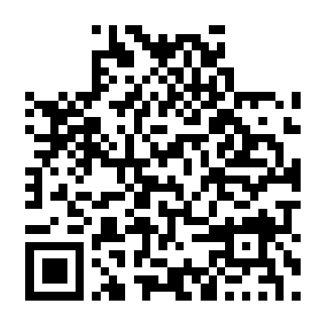
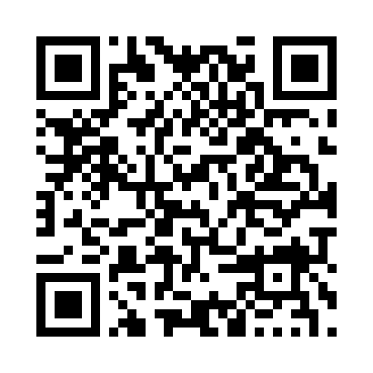
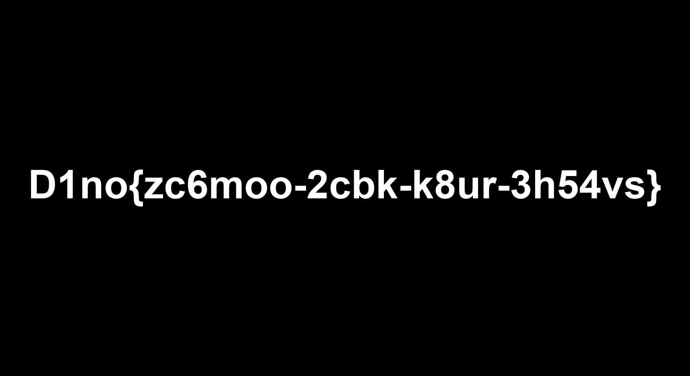

# 第七届信安大挑战 Misc WP

这次是刚开始接触 CTF，主要做了 Misc。刚开始连查看源代码、解压和打开工具这些操作都不熟悉，很多地方是在查资料、看提示和 AI 辅助下才做出来的。这份 WP 按照做题时的过程整理，记录一下每一步在找什么，以及为什么要这样做。

这份 WP 是赛后的学习复盘。做题时，我借助了 AI 解释线索、指导工具操作，后面几题还请它协助分析附件和编写脚本。每题会简要记录获得的帮助，以及自己当时卡住的地方。

这次完成的 Misc 是：CHECK_IN、Sky1ine的消息、双面照片、你真的看到了吗、熬夜的代价、消失的文件去哪了。截图里这些题都有插旗标记。

## 1. CHECK_IN

题目只有一个 `FLAG_IS_HERE~` 链接，点进去是一篇微信公众号文章。

我向 AI 询问了链接题的检查思路。开始以为要在网页代码里面找东西，就打开了网页源代码，搜索 `flag{`，结果没有找到。后来回到文章本身，把文章往下翻，在结尾直接看到了：

```text
D1no{7th_Challenge_Hidden_In_Plain_Sight}
```

这道题最主要的问题是我没有先把文章看完。原来 flag 不一定都长成 `flag{...}`，这个比赛用的是 `D1no{...}`，只搜前一种也会漏掉。

以后遇到网页链接，我会先看页面内容和文章结尾，再根据线索检查源代码。查看源代码是一个方法，不是每个链接题都要靠它解决。

## 2. Sky1ine的消息

附件是一个 TXT。打开后是一大串颜文字，开头类似：

```text
ﾟωﾟﾉ= /｀ｍ´）ﾉ ~┻━┻
```

题面提到了 `aa`、`brainf*k`、`栏4w` 和表情。做完以后回头看，前两个分别对应 AAEncode 和 Brainfuck，`栏4w` 可以往栅栏、四层的方向理解。第一次看这些提示时，我完全没有对应上，所以求助于 AI 识别编码、解释题面，并帮我找到相应工具。下面按三层处理过程记录。

### 第一层：AAEncode

这种颜文字形式对应 AAEncode，是一种把 JavaScript 代码变成颜文字样子的混淆方式。

打开 AAEncode 解码工具，把 TXT 里面的完整内容复制进去，选择解码。这里使用的页面是：

<https://toolwa.com/aaencode/>

解出来以后没有直接得到 flag，而是又出现一串加号、减号和方括号，例如：

```text
+++++ +++[- >++++ ++++< ]>+++ +.
```

### 第二层：Brainfuck

Brainfuck 是一种编程语言，常见指令就是下面这些符号：

```text
> < + - . , [ ]
```

打开 dCode 的 Brainfuck 页面：

<https://www.dcode.fr/brainfuck-language>

把上一层结果放到 `Brainfuck Interpreter` 的代码框里，点击 `EXECUTE`。下面的 Encoder 是把普通文字转成 Brainfuck，用的方向不同。

运行后得到：

```text
Dk__o1Sye1oHsmn{1nsSadeoi_n}
```

这次已经能看到花括号了，但是字母顺序不对，还没有结束。

### 第三层：四层栅栏密码

根据前面的提示，把题目中的“栏”和“4”与四层栅栏密码联系起来，再用工具尝试。这里用的是按折线排列的 Rail Fence，也叫 Zig-Zag。

打开：

<https://www.dcode.fr/rail-fence-cipher>

把字符串放进解密区域，层数设置为 `4`，从上方开始，不设置初始偏移，然后解密，得到：

```text
D1no{Sky1ine_1s_So_Handsome}
```

这道题的过程就是：

```text
颜文字 → AAEncode 解码 → Brainfuck 运行 → 四层栅栏解密 → flag
```

这道题让我第一次认识了这几种形式，也知道了解出一层还要继续观察输出。以后再遇到一堆符号，可以先看它用了哪些字符，再结合题面判断方向。

## 3. 双面照片

题面说把一句话分成三截，分别放在“照片背面”“落款”和另一张纸的“每一粒光”里。

解压附件后有两张图片：

```text
photo.png
wallpaper.png
```

直接打开看都是正常图片，没有看到答案。我求助于 AI 理解“背面”和“落款”的含义，并请它解释英文提示、指导 StegSolve 的参数设置和提取结果的读取。

### 先检查 photo.png 里有没有文字

用记事本打开 `photo.png` 会显示很多乱码。这是正常的，因为图片本来就不是文本文件。但是图片里面也可能保存着能直接读到的文字。

搜索 `D1no`，找到了第一截：

```text
D1no{f1bea49f-5b7
```

在开头附近还能看到 `Artist` 字段，后面跟着：

```text
8-4e4f-aef0-
```

Artist 是作者的意思，正好能和题目的“落款”对应起来。图片除了画面，还能带有作者等附加信息。

另外还找到一段英文提示，大意是：

> 在 wallpaper.png 中，按从左到右、从上到下的顺序，取每个像素的 B、G、R 通道最低位，拼成字节。得到的是 Base64 文本，先 Base64 解码，再用 zlib 解压。

这段提示给出了操作顺序，但我当时看不懂几个名词之间的关系。解释后才知道：先从像素里提取数据，再解码，最后解压，不能只选其中一步。

### 用 StegSolve 提取 wallpaper.png

工具能运行后，把原始的 `wallpaper.png` 拖进 StegSolve，点 `Analyse → Data Extract`。

参数设置如下：

| 选项 | 设置 |
|---|---|
| Red、Green、Blue | 每一行只勾选最右边的 `0` |
| Alpha | 不勾选 |
| Extract By | Row |
| Bit Order | MSB First |
| Bit Plane Order | BGR |

第 `0` 位就是最低位。Row 对应逐行读取，BGR 对应提示里的蓝、绿、红顺序。


点击 Preview，并把预览滚到最开头。开头可以看到一小段正常文字，后面还有很多杂数据。这里不能认为整个提取结果都应该是 Base64。

点击 `Save Bin` 保存原始提取结果。用记事本打开时又是乱码，我以为提取失败了。后来按 AI 提供的 PowerShell 命令读取原始字节，才确认开头有一段可读字符串。本题验证使用的前 28 个字节是：

```text
eNpLNkhKMTdJNESxMTSrBQAbLAPY
```

28 是这道题实际验证出来的长度，不是其他题也固定取 28 个字节。

### 按顺序解码和解压

打开 CyberChef：

<https://gchq.github.io/CyberChef/>

把上面的字符串放进 Input，中间依次添加：

```text
From Base64
Zlib Inflate
```

`Inflate` 是解压，不能选成压缩用的 `Deflate`。我也试过 `Detect File Type`，但那个只是识别文件类型，不会直接解压。

输出得到最后一截：

```text
c0bd74a6d416}
```

把三段按顺序拼起来，中间不加空格：

```text
D1no{f1bea49f-5b78-4e4f-aef0-c0bd74a6d416}
```

题面标注的格式带 `.zip`，按当时记录的提交形式为：

```text
D1no{f1bea49f-5b78-4e4f-aef0-c0bd74a6d416}.zip
```

这道题让我卡了很久的地方其实也包括安装 Java、打开 StegSolve、找文件的位置，以及保存后为什么是乱码。题目核心是图片元数据、最低位隐写、Base64 和 zlib 解压，其中像素如何拼成字节还需要继续复习。

## 4. 你真的看到了吗

附件是 `你真的看到了吗.zip`，里面有 `111.txt` 和 `hhh.zip`。这道题的层数比较多，我求助于 AI 分析压缩包、寻找隐写线索，并借助它提供的命令和脚本恢复图片、修复二维码。下面整理各层的处理过程。

### 外层 ZIP 是伪加密

打开压缩包时能看到文件，但显示有密码保护。分析附件结构后发现，本地文件头和中央目录的加密标志不一致。

我理解的伪加密就是：文件实际没有按要求加密，但是信息里面写着“它加密了”，有的解压工具就会要求密码。

先复制一份附件，在 HexEd.it 中打开副本，找到中央目录里的：

```text
50 4B 01 02
```

本题两条记录的加密标志都是 `09 00`，改成 `08 00`，只去掉表示加密的那一位。本附件需要修改的字节位置是 `0x363F` 和 `0x368C`。

保存副本后解压，得到：

```text
111.txt
hhh.zip
```

这些地址只适用于本题，换一个压缩包不能直接照着改。

### TXT 中真正的密码是看不见的字符

`111.txt` 里面有一段很显眼的编码字符串。经过 Base64、Base58、Base32 解码后，得到的却是：

```text
emmm...你来这里看什么，这里什么都没有
```

这条路没有得到可用密码。结合题目名字继续检查，发现 TXT 中还有一些肉眼看不见的字符，也就是零宽等不可见字符。

按 Unicode 隐写的方向检查时，把 TXT 全部复制到 Unicode 隐写工具，不能只复制看得见的部分：

<https://330k.github.io/misc_tools/unicode_steganography.html>

在 `Text in Text Steganography Sample` 中，把全文放入 `Steganography Text`，使用默认字符集合，点击 Decode，查看 Hidden Text，得到：

```text
neworld_pwd
```

用这个密码解开 `hhh.zip`，得到 `1.docx` 和 `nnn.zip`。

### Word 中还有白色文字

`1.docx` 看起来没有明显提示，但里面有白色文字。全选文字，把字体颜色改成黑色，可以读到：

```text
压缩包里面是png图片哦
```

这说明 `nnn.zip` 里面的内容应该是 PNG 图片，即使它没有写图片扩展名。

### 根据 PNG 文件头恢复加密内容

这次 `nnn.zip` 是真加密，不能继续用修改标志的方法。检查得知它使用 `ZipCrypto`，压缩方式为 `Store`。Store 的意思是里面的文件没有压缩。

PNG 开头有固定内容，因此可以把这一小段已知数据交给 bkcrack，尝试恢复内容。这叫已知明文攻击，也是我需要求助的难点。根据 AI 的解释，这次选择这一方法的依据是：已知里面是 PNG，PNG 开头固定，文件又没有压缩，并且使用的是 ZipCrypto。

使用的 16 字节 PNG 开头是：

```text
89 50 4E 47 0D 0A 1A 0A 00 00 00 0D 49 48 44 52
```

将这些字节保存成 `png-header.bin`，把它和 `nnn.zip`、`bkcrack.exe` 放在同一文件夹，执行：

```powershell
.\bkcrack.exe -C .\nnn.zip -c nnn -p .\png-header.bin -d .\recovered.png
```

本次恢复的内部密钥为：

```text
a81b3cc3 2e42b532 fcadbef1
```

复现时也可以直接用这组已恢复的密钥提取图片：

```powershell
.\bkcrack.exe -C .\nnn.zip -c nnn -k a81b3cc3 2e42b532 fcadbef1 -d .\recovered.png
```

恢复出的文件是 3208 字节，CRC32 为 `AE8242BD`，与压缩包中的记录一致。

### 修复二维码

得到的是二维码，但左上和右上的两个定位方框被擦掉了，只剩左下角的完整方框。



二维码的这些定位方框有固定形状。把缺少的两个方框补回去，并且和原来的小格对齐，再扫码。

修复脚本只补回两个固定形状的定位框，没有重新猜中间的数据部分。



扫描得到：

```text
D1no{A7k2_9mQx_3Zp8_Lr5T}
```

这道题最明显的特点就是“看起来没有，实际还有”：压缩包看起来加密、TXT 有看不见的字符、Word 有白字、二维码也缺了东西。我一开始不会把这些线索联系在一起。

## 5. 熬夜的代价

题面说文件一层套一层，还忘记了密码。这道题我卡在文件拆分和密码恢复上，求助于 AI 分析附件，并借助脚本完成 CRC32 枚举和图片异或。下面是整理后的解题路线。

### 图片里面还有压缩包

解压 `challenge.zip`，得到 `ccc.jpg`。图片可以正常打开，但分析文件结构后发现，里面还夹着一个 ZIP。

本题的文件排列为：

```text
JPEG 图片 + ZIP 压缩包 + 同样的 JPEG 图片
```

ZIP 在文件中的起始偏移是 `687393`，长度 `3140258` 字节。按这个范围提取，得到的压缩包里有：

```text
hint.txt
cccccrcc.zip
xxxxor.zip
```

这里不能只因为搜到了 `PK` 就认定一定有压缩包，还要确认结构能够被正常解析。

### 提示文件的伪加密和真正的密码

`hint.txt` 的加密标志不一致，修复后可以读到提示，说密码全是小写字母。

但另外两个 ZIP 条目是真加密，不能把它们的标志也随便清掉。

密码恢复这一步比较费时间。前面尝试较短的小写字母密码没有成功，后续分析利用内层 ZIP 的固定结构，通过 bkcrack 恢复密钥，再恢复出了密码：

```text
neworld
```

用它能够解出两个内层压缩包。这个密码是恢复后验证得到的，不是题面直接给出来的。

### 单字节文件可以通过 CRC32 枚举内容

`cccccrcc.zip` 里面有 `1.txt` 到 `14.txt`，每个文件原始大小只有 1 字节。

虽然文件加密了，但 ZIP 中记录的 CRC32 可以看到。1 字节只有 256 种可能，所以可以把每种可能都算一下 CRC32，找到匹配的字节。

我当时不理解 CRC32 为什么能用来找内容，请 AI 解释后才知道，关键是候选范围很小。脚本枚举出对应字节，再按数字编号拼接，得到：

```text
D1no_????_2026
```

它是下一层密码的格式，不是最终 flag。CRC32 也不是能把所有文件直接解密的方法，这里能做是因为每个文件只有 1 字节。

继续恢复并验证后，可用的密码是：

```text
D1no_newo_2026
```

用它解开 `xxxxor.zip`，得到 `final.png`。

### 两张噪声图进行异或

`final.png` 打开是噪声图。检查文件结构后发现，这个文件实际上拼接了两张 PNG，第二张从偏移 `1569121` 开始。

两张图都是 `1693 × 925` 的灰度图片，分别占 `1569121` 字节。拆开后对对应位置的像素做 XOR，也就是异或。

`xxxxor` 这个名字也能往 XOR 的方向理解。最初我并不知道这个词是什么意思，是做完以后才对应起来的。

拆分后使用 Python 处理图片，核心操作是：

```python
result = numpy.bitwise_xor(first, second)
```

得到的图片中显示了 flag：



```text
D1no{zc6moo-2cbk-k8ur-3h54vs}
```

题面要求的格式带 `.zip`，当时记录的提交形式是：

```text
D1no{zc6moo-2cbk-k8ur-3h54vs}.zip
```

其中 `zc6moo` 结尾是两个小写字母 `o`。

为了方便重新跑通，附上之前验证过的[快速复现脚本](熬夜的代价-快速复现.py)。这个脚本使用已经恢复的密码，用于复现后续提取和图片处理，不包含耗时的密码攻击过程。

## 6. 消失的文件去哪了

题目给了一份整盘镜像，要找回真正生效的配置文件，并根据端口号和文件哈希拼出答案。

解压 `lab_disk.zip` 得到 `lab_disk.img`，大小是 64 MiB。这是磁盘镜像，不是普通文本文件。

### 先找到被删文件的记录

磁盘镜像是我第一次接触的内容。我求助于 AI 解析文件系统、解释目录记录和簇号，再跟着分析结果在 HexEd.it 中检查。下面的地址和提取范围来自这次辅助分析，记录下来方便复习。镜像使用的是 FAT32 文件系统。

在 `0x1FC600` 附近能看到 PROJECT 目录的内容。在 `0x1FC640` 位置有一条配置文件记录，开头是 `E5`，后面还能认出类似 `ONFIG INI` 的内容。

FAT 目录记录开头的 `E5` 表示这条记录被删除了。这里可以判断原来有一个 `CONFIG.INI`。

删除文件不一定马上把内容全部擦掉，有时只是把目录记录标记成删除，因此还有恢复的可能。

### 原配置内容已经被日志覆盖

根据目录记录，原配置从第 4 簇开始。“簇”可以先理解为磁盘用来存文件的一块空间。

这个位置对应镜像中的 `0x1FC800`。跳过去检查后发现是运行日志，不是配置内容。说明不能只把删除标记改回去，因为原来的数据位置已经被别的文件使用了。

目录里还有 `CONFIG.BAK`，内容中有：

```ini
port=9318
mode=testing
```

它属于另外一份测试配置，不能看到一个端口就直接当答案。

### 从删除的备份中找回完整配置

继续检查删除记录，找到被删除的 `BACKUP.ZIP`，它从第 9 簇开始，文件大小是 391 字节。

对应的镜像位置是：

```text
起始位置：0x1FD200
长度：391 字节
结束位置：0x1FD386（包含最后这个字节）
```

跳过去可以看到 ZIP 文件头：

```text
50 4B 03 04
```

提取这 391 个字节，保存为 ZIP，能够正常打开。注意这里是提取镜像里面的一小段，不是直接把整个 IMG 改名成 ZIP。

恢复出的备份中有 `project/config.ini` 和 `project/result.csv`。其中 CSV 与当前目录中的结果文件一致，结合配置里的 `training`，比旧的测试配置更符合本题场景。

找回的完整配置如下，文件使用 LF 换行，最后一行后也有换行：

```ini
[server]
host=10.10.10.56
port=8997
mode=training

[auth]
token=train-0e17c0f3
enabled=true

[backup]
target=/data/backup
interval=3600
```

### 计算哈希并拼接答案

题目需要的是 `[server]` 段的端口，所以取 `8997`。

对恢复出来的原文件计算 SHA-256。在 PowerShell 中可以运行下面这条命令，路径换成文件实际位置：

```powershell
Get-FileHash -LiteralPath '.\config.ini' -Algorithm SHA256
```

得到：

```text
df33edc3bf674254357ff733361783031af16fe4942b7bd2e0e0c7ee2f8f6327
```

取前 16 位，转为小写：

```text
df33edc3bf674254
```

按题目要求拼起来：

```text
D1no{8997_df33edc3bf674254}.zip
```

这里要对恢复的原始文件算哈希，不能根据上面的文字重新打一个文件再算。换行方式、空格或者末尾换行发生变化，哈希也会变。

## 做完后的记录

这次最开始以为 Misc 就是找工具解码，后面发现还要判断文件里面到底藏了什么。工具只是完成其中一步，最难的往往是知道下一步该查哪里。

目前比较有印象的是常见编码的样子、图片里的附加文字，以及按提示提取数据的过程。ZipCrypto 已知明文攻击和 FAT 文件恢复对我来说还比较难，需要结合这份记录重新操作，再补相关原理。

这次也遇到了很多操作上的问题，比如打开 ZIP 和解压 ZIP 没分清、Java 没安装导致 JAR 打不开、图片用记事本打开后不知道为什么乱码。把这些过程记下来，下次至少可以少卡一会儿。

## 接下来需要自己复习的内容

先复习最基本的操作：分清打开压缩包和解压，确认文件路径，理解为什么图片和二进制文件用记事本打开会乱码。再把编码题和图片提取题重新做一次，尝试在不看 AI 回答的情况下说明每一步的输入、输出和依据。

后面再学习 ZipCrypto 已知明文攻击、FAT32 目录记录和文件恢复。希望下次复现时，不只是知道点哪里，还能说明为什么选择这一步。

## 附：本次记录的答案

下面带 `.zip` 的条目按此前题面和解题记录保留这个后缀。

| 题目 | Flag |
|---|---|
| CHECK_IN | `D1no{7th_Challenge_Hidden_In_Plain_Sight}` |
| Sky1ine的消息 | `D1no{Sky1ine_1s_So_Handsome}` |
| 双面照片 | `D1no{f1bea49f-5b78-4e4f-aef0-c0bd74a6d416}.zip` |
| 你真的看到了吗 | `D1no{A7k2_9mQx_3Zp8_Lr5T}` |
| 熬夜的代价 | `D1no{zc6moo-2cbk-k8ur-3h54vs}.zip` |
| 消失的文件去哪了 | `D1no{8997_df33edc3bf674254}.zip` |

另有一道 AES-CTR 复用密钥流的密码题，属于 Crypto，没有放进这份 Misc WP。
